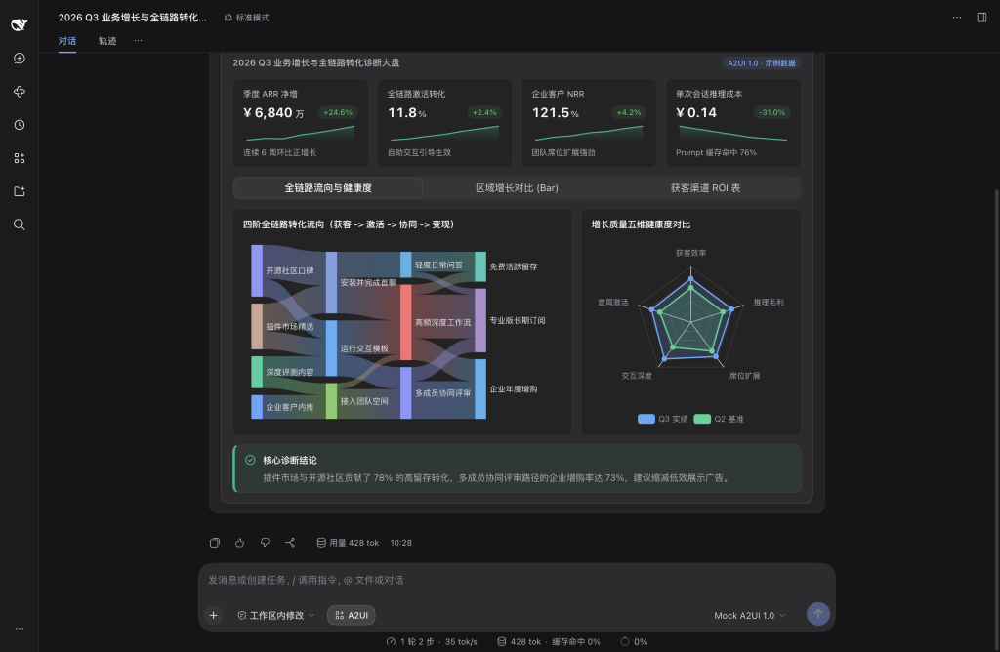
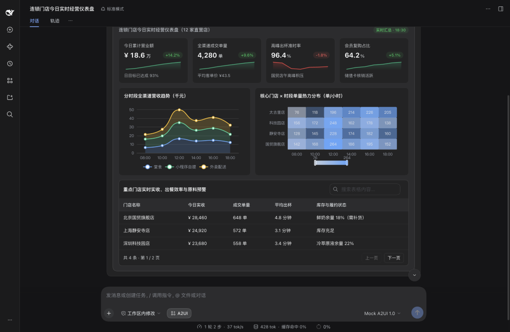
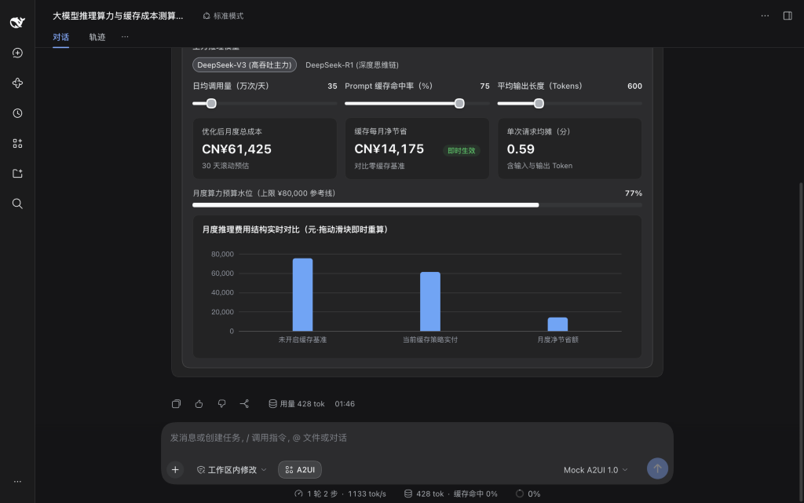
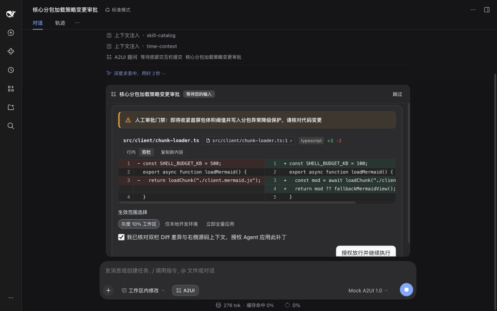
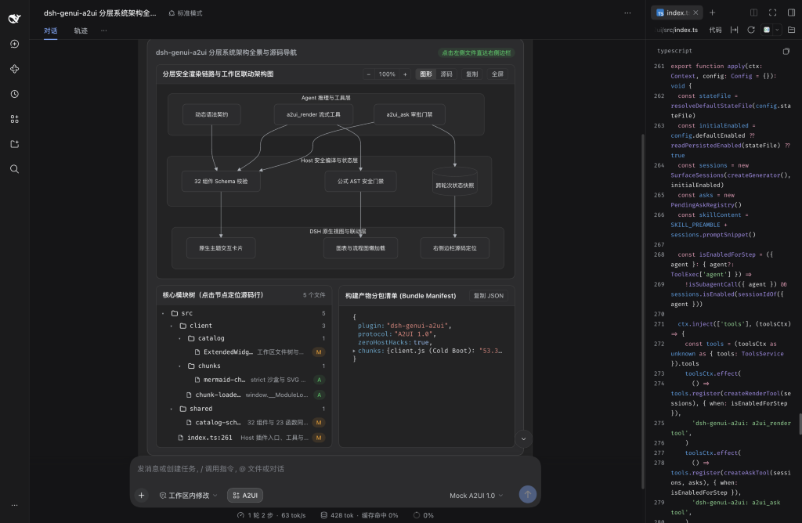
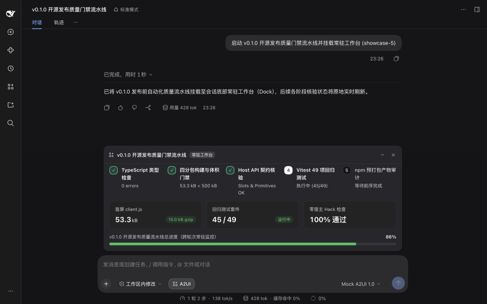

# dsh-genui-a2ui

[简体中文](./README.md) | **English** | [Offline component handbook](./docs/dsh-genui-a2ui-component-library.html) | [Developer and architecture guide](./docs/DEVELOPMENT.md)

**Don't just chat. Let AI speak in interfaces.**

`dsh-genui-a2ui` brings Google's open A2UI (Agent to User Interface) standard to DeepSeek Harness. Simple questions still get fast text replies. When plain text falls short, AI renders clickable, draggable, filterable native UI directly inside your chat.

## Quick start

Install the plugin in DeepSeek Harness Desktop:

```bash
dsh plugin --profile desktop add dsh-genui-a2ui
```

To install from a local clone instead, run `npm ci && npm run build` and then `dsh plugin --profile desktop add link:./dsh-genui-a2ui`.

Restart DeepSeek Harness Desktop and ask questions as usual. Click **A2UI** above the input box or type `/a2ui off` anytime to switch back to plain text.

## See it in action

### Diagnose multi-stage conversion flows and health scores

Equal-height KPI cards with sparklines pair with a four-stage Sankey flow and a five-axis radar chart in one view. Switch tabs to inspect regional revenue bars or filter channel ROI rows.



### Monitor live store operations and stock alerts

Track daily chain revenue, order volume, and peak-hour fulfillment in real time. Combine stacked channel area curves, store-by-hour order heatmaps, and searchable inventory warning tables on one screen.



### Model costs and returns with live sliders

Drag sliders or switch tiers to test budget, rate, or traffic assumptions right in chat. Totals, margins, and charts recalculate locally in 0 ms without spending extra tokens.



### Review diffs before approving critical actions

Pause high-impact changes with a review card above the chat input. Inspect the split code diff, select a rollout scope, and confirm before execution continues.



### Map layered system architecture to live source files

Render multi-layer Mermaid architecture diagrams alongside a workspace file tree and JSON inspector. Click any file node to open that exact line inside the right sidebar.



### Pin live task progress above the chat input

Keep multi-stage pipelines anchored at the bottom of the window. Stages and completion rates update in place while you scroll through earlier messages.



## Why A2UI

- **Safe by design**: Built on Google's A2UI 1.0 specification, models output declarative JSON only and never execute untrusted HTML or scripts.
- **Native look and feel**: Every surface renders with DeepSeek Harness UI primitives, adapting automatically to light mode, dark mode, and community themes.
- **Zero host patches, fast startup**: Built on official plugin APIs with a 12.6 KB gzipped core; chart and diagram engines load only on demand.

## Component catalog

Includes 32 native UI components, 14 interactive chart types, and full Mermaid diagram support:

| Category | Components | Purpose |
| :--- | :--- | :--- |
| **Layout containers** | `Card`, `Row`, `Column`, `Tabs`, `Accordion`, `List`, `Modal`, `Divider` | Multi-column dashboards, tabbed views, collapsible panels, and modal details |
| **Metrics and status** | `Stat`, `KeyValue`, `Steps`, `Progress` | KPI cards with deltas and sparklines, spec grids, step timelines, and progress bars |
| **Charts and tables** | `Chart`, `Mermaid`, `Table` | 14 interactive chart types, architecture diagrams, and searchable, sortable, paginated tables |
| **Code and workspace** | `Code`, `DiffView`, `FileTree`, `JsonTree` | Highlighted code, unified or split diffs, clickable workspace file trees, and JSON inspectors |
| **Form controls** | `Button`, `Slider`, `ChoicePicker`, `TextField`, `CheckBox`, `DateTimeInput` | Sliders, single or multi-select chips, validated inputs, date pickers, and action buttons |
| **Typography and alerts** | `Text`, `Callout`, `Badge`, `Icon` | Rich text, color-coded callouts, status badges, and semantic icons |
| **Media** | `Image`, `AudioPlayer`, `Video` | Inline image previews, audio players, and video playback |

- **14 interactive charts (`Chart`)**: Vertical and horizontal ranking bars (`bar`), `line`, `area`, donut and pie (`pie`), bubble and `scatter`, `radar`, `funnel`, `gauge`, `heatmap`, `treemap`, `sankey`, `boxplot`, network (`graph`), and `candlestick`.
- **Architecture and flow diagrams (`Mermaid`)**: Flowcharts, sequence diagrams, state machines, class diagrams, ER diagrams, Gantt charts, Git graphs, and mindmaps with zoom, fullscreen view, and source toggle.

## Documentation and license

- [Developer and architecture guide (English)](./docs/DEVELOPMENT.md) | [开发与架构文档（简体中文）](./docs/DEVELOPMENT.zh-CN.md)
- [Interactive component handbook (offline single-file HTML, download and open in browser)](./docs/dsh-genui-a2ui-component-library.html)
- [Contributing guide](./CONTRIBUTING.md) | [Security policy](./SECURITY.md) | [Changelog](./CHANGELOG.md)
- Released under the [MIT License](./LICENSE). See [THIRD_PARTY_NOTICES.md](./THIRD_PARTY_NOTICES.md) for third-party open-source notices.
