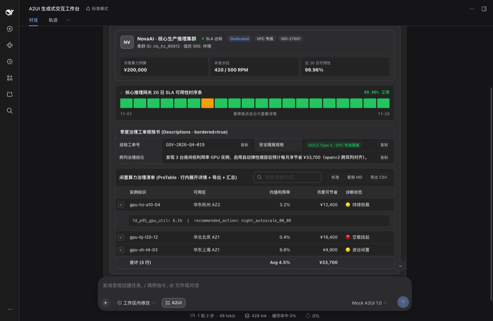
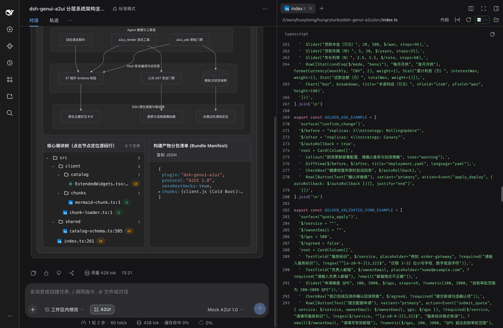

# dsh-genui-a2ui

[简体中文](./README.md) | **English** | [Developer and architecture guide](./docs/DEVELOPMENT.md)

[](https://github.com/Geekhyt/dsh-genui-a2ui/actions/workflows/ci.yml) [](https://www.npmjs.com/package/dsh-genui-a2ui) [](./LICENSE) [](https://github.com/google/A2UI) [](./package.json)

**Don't just chat. Let AI speak in interfaces.**

`dsh-genui-a2ui` brings Google's open A2UI (Agent to User Interface) standard to DeepSeek Harness. Simple questions still get fast text replies. When plain text falls short, AI renders clickable, draggable, filterable native UI directly inside your chat.

## Quick start

**Option 1: Install directly inside DeepSeek Harness (recommended, no terminal or restart needed)**

Open **Plugins** in the left sidebar, click **Add plugin**, enter `dsh-genui-a2ui`, and choose **Enable now**.

**Option 2: Install via CLI**

```bash
dsh plugin --profile desktop add dsh-genui-a2ui
```

To install from a local clone instead, run `npm ci && npm run build` and then `dsh plugin --profile desktop add link:./dsh-genui-a2ui`. To upgrade later, run `dsh plugin --profile desktop add dsh-genui-a2ui@latest`; to uninstall, run `dsh plugin --profile desktop remove dsh-genui-a2ui`.

Once enabled, ask questions as usual. Click **A2UI** below the input box or type `/a2ui off` anytime to switch back to plain text.

<details>
<summary><strong>Click to expand 15 ready-to-run example prompts</strong></summary>

1. **Executive conversion and health dashboard**: `Build a quarterly growth and conversion diagnostic dashboard with four KPI cards with sparklines on top, a four-stage Sankey flow paired with a five-axis health radar chart side by side, plus tabs for regional growth bars and a searchable channel ROI table.`
2. **Live multi-store operations dashboard**: `Create a live chain coffee store operations dashboard showing daily revenue, total orders, peak fulfillment rate, and stock alerts, paired with hourly channel area curves, a store-by-hour order heatmap, and a searchable inventory warning table.`
3. **Zero-latency LLM inference and cache simulator**: `Build a zero-latency LLM inference and prompt-cache cost calculator where I can switch models (DeepSeek-V3 vs DeepSeek-R1), drag sliders for daily call volume, prompt cache hit rate, and average output tokens, and see monthly spend, net cache savings, budget utilization, and a cost breakdown bar chart update live.`
4. **GPU tier check-cards, precision steppers & follow-up prompts**: `Build a private LLM cluster capacity and GPU tier planner using visual check-cards to switch GPU instance tiers, precision number steppers for replica count and per-pod concurrency, multi-select tags for failover zones, a hierarchical tree-select for the target service, and clickable next-step prompt cards at the bottom.`
5. **Dedicated cluster SLA strip, bordered descriptions & expandable ProTable**: `Generate a quarterly dedicated inference cluster governance workbench with a cluster health header and 20-day SLA uptime strip on top, bordered specification descriptions in the middle, and an expandable, CSV/Markdown-exportable ProTable of idle GPU optimization targets with summary totals at the bottom.`
6. **Service health topology, APM trace waterfall & log triage**: `Diagnose a checkout API P99 latency spike by combining a live health-colored service dependency DAG (including fallback bypass and retry arcs), a distributed trace waterfall tree with latency share bars, and an error stack-trace log viewer linked to workspace source files.`
7. **High-risk DDL approval gate, runbook terminal & maintenance schedule**: `Prepare an online cold-partition archival workflow for our core billing table with a switch-gated high-risk approval card, pre-flight backup verification terminal runbook, and a maintenance window Gantt schedule bar.`
8. **Architecture trade-off comparison matrix & source citations**: `Compare PostgreSQL pgvector, Milvus, and Elasticsearch for production hybrid search with a workload tier segmented switcher on top, a multi-criteria trade-off matrix highlighting the recommended stack, and clickable benchmark citations at the bottom.`
9. **HTTP API contract workbench, preset date range & radial SLO gauges**: `Build an API rate-limit and health inspection panel combining three radial SLO gauges and a preset date-range picker on top with an interactive HTTP endpoint card supporting request/response JSON trees and shell-safe cURL copy.`
10. **Incident response Kanban, cross-zone heat matrix & execution receipt**: `Summarize a multi-AZ failover drill on one screen with a three-lane action Kanban board, an incident timeline, a quarterly cross-zone P99 latency heat matrix, and a structured drill verification receipt.`
11. **Code diff approval gate**: `Suppose you are updating our production gateway canary weight from 5% to 20% and adding a circuit-breaker timeout. Pause with a review card showing the split config diff, target cluster selector, and auto-rollback switch for my confirmation before proceeding.`
12. **Workspace architecture diagram and source explorer**: `Analyze the architecture of this workspace, render a layered Mermaid diagram alongside a clickable file tree and config JSON inspector so I can open any file directly in the right sidebar.`
13. **Persistent bottom task tracker**: `Pin a five-stage release verification tracker above the chat input showing step status and overall completion percentage across typecheck, bundle build, host API check, test suite, and tarball audit.`
14. **Market candlestick and volatility distribution**: `Create a 10-day market review dashboard combining a sentiment gauge with a daily OHLC candlestick chart and a sector return boxplot side by side.`
15. **Incident triage accordion and detail modal**: `Generate a layered API latency incident report using collapsible accordions for root-cause summary, key-value metrics, and mitigation steps, plus a modal button to inspect full slow-query details.`

</details>

## See it in action

### Diagnose multi-stage conversion flows and health scores

Equal-height KPI cards with sparklines pair with a four-stage Sankey flow and a five-axis radar chart in one view. Switch tabs to inspect regional revenue bars or filter channel ROI rows.


### Monitor live store operations and stock alerts

Track daily chain revenue, order volume, and peak-hour fulfillment in real time. Combine stacked channel area curves, store-by-hour order heatmaps, and searchable inventory warning tables on one screen.


### Plan GPU capacity with visual check-cards, precision steppers, and follow-up prompts

Switch GPU instance tiers via rich check-cards or adjust replica steppers to recalculate cluster RPS and monthly budgets locally in 0 ms. Pair multi-tag zone selectors and hierarchical service breadcrumbs with clickable next-step prompt cards at the bottom.


### Govern dedicated clusters with SLA strips, bordered descriptions, and expandable ProTables

Combine production cluster headers, hoverable SLA uptime strips, and bordered specification tables in one view. Below, the enterprise ProTable adds one-click Markdown/CSV export, automatic numeric summary footers, and inline expandable row drawers.



### Triage latency spikes across service health DAGs, APM trace waterfalls, and logs

Render zero-dependency health-colored service dependency DAGs alongside a distributed trace waterfall tree with proportional latency bars and an error log console linked directly to workspace source lines.


### Model costs and returns with live sliders

Drag sliders or switch tiers to test budget, rate, or traffic assumptions right in chat. Totals, margins, and charts recalculate locally in 0 ms without spending extra tokens.


### Review diffs before approving critical actions

Pause high-impact changes with a review card above the chat input. Inspect the split code diff, select a rollout scope, and confirm before execution continues.


### Map layered system architecture to live source files

Render multi-layer Mermaid architecture diagrams alongside a workspace file tree and JSON inspector. Click any file node to open that exact line inside the right sidebar.



### Pin live task progress above the chat input

Keep multi-stage pipelines anchored at the bottom of the window. Stages and completion rates update in place while you scroll through earlier messages.


## Why A2UI

- **Safe by design**: Built on Google's A2UI 1.0 specification, models output declarative JSON only and never execute untrusted HTML or scripts.
- **Native look and feel**: Every surface renders with DeepSeek Harness UI primitives, adapting automatically to light mode, dark mode, and community themes.
- **Zero host patches, fast startup**: Built on official plugin APIs with a 16.5 KB gzipped core; chart and diagram engines load only on demand.

## Component catalog

Includes 57 native UI components, 14 interactive chart types, and full Mermaid diagram support:

| Category | Components | Purpose |
| :--- | :--- | :--- |
| **Layout & entity headers** | `Card`, `Row`, `Column`, `Grid`, `Tabs`, `Accordion`, `List`, `Modal`, `Divider`, `EntityHeader` | Responsive multi-row CSS grids, multi-column dashboards, tabs, collapsible panels, modals, and B2B object headers |
| **Metrics, SLOs & outcomes** | `Stat`, `MetricRing`, `Tracker`, `KeyValue` (bordered Descriptions), `Steps`, `Timeline`, `Schedule`, `Progress`, `Result` | KPI cards, radial rings, Tremor SLA/category bars, bordered descriptions, timelines, Gantt schedules, and outcome receipts |
| **Charts, topology & ProTable** | `Chart`, `ServiceGraph`, `Mermaid`, `Comparison`, `Matrix`, `Table` (expandable ProTable), `Tree`, `Kanban` | 14 chart kinds, live health DAGs, trade-off & heat matrices, expandable/exportable ProTables, org/trace trees, and Kanban boards |
| **DevOps, APIs & risk gates** | `Code`, `Terminal`, `ApiEndpoint`, `ApprovalCard`, `DiffView`, `LogViewer`, `FileTree`, `JsonTree`, `SourceList` | Code blocks, runbook terminals, HTTP API workbenches, risk approval gates, diffs, logs, file trees, and citations |
| **Forms & prompt cards** | `Button`, `NumberInput`, `MultiSelect`, `DateRange`, `TreeSelect`, `CheckCard`, `Segmented`, `Select`, `Switch`, `Slider`, `ChoicePicker`, `TextField`, `CheckBox`, `DateTimeInput` | Precision steppers, multi-tag selects, preset date ranges, hierarchical tree selects, visual check/prompt cards, switches, sliders, and validated inputs |
| **Typography and alerts** | `Text`, `Callout`, `Badge`, `Icon` | Rich text, color-coded callouts, status badges, and semantic icons |
| **Media** | `Image` (native lightbox), `AudioPlayer`, `Video` | Click-to-zoom lightbox image previews, audio players, and video playback |

- **14 interactive charts (`Chart`)**: Vertical and horizontal ranking bars (`bar`), `line`, `area`, donut and pie (`pie`), bubble and `scatter`, `radar`, `funnel`, `gauge`, `heatmap`, `treemap`, `sankey`, `boxplot`, network (`graph`), and `candlestick`.
- **Architecture and flow diagrams (`Mermaid`)**: Flowcharts, sequence diagrams, state machines, class diagrams, ER diagrams, Gantt charts, Git graphs, and mindmaps with `10%–2000%` lossless vector zoom, pointer-anchored wheel zoom, drag-to-pan, fit-to-viewport, fullscreen view, and source toggle.

## Documentation and license

- [Developer and architecture guide (English)](./docs/DEVELOPMENT.md) | [开发与架构文档（简体中文）](./docs/DEVELOPMENT.zh-CN.md)
- [Contributing guide](./CONTRIBUTING.md) | [Code of conduct](./CODE_OF_CONDUCT.md) | [Security policy](./SECURITY.md) | [Changelog](./CHANGELOG.md)
- Released under the [MIT License](./LICENSE). See [THIRD_PARTY_NOTICES.md](./THIRD_PARTY_NOTICES.md) for third-party open-source notices.
