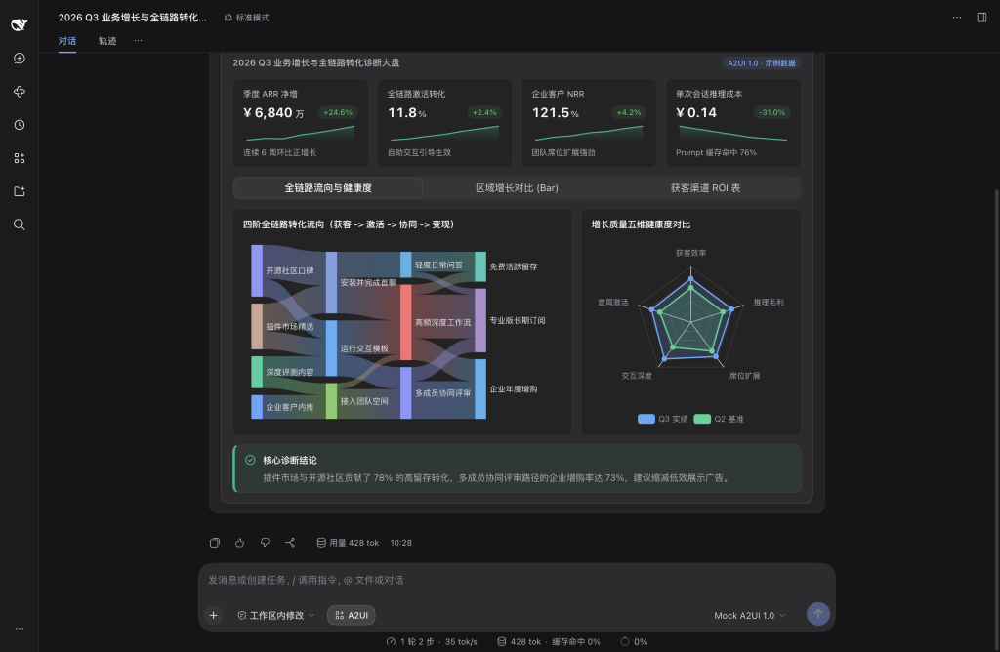
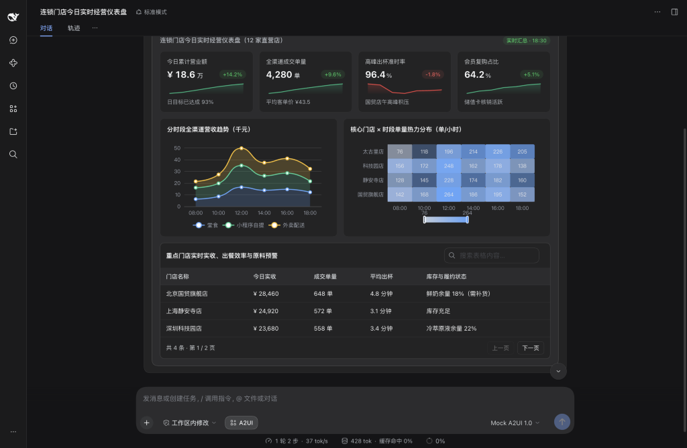
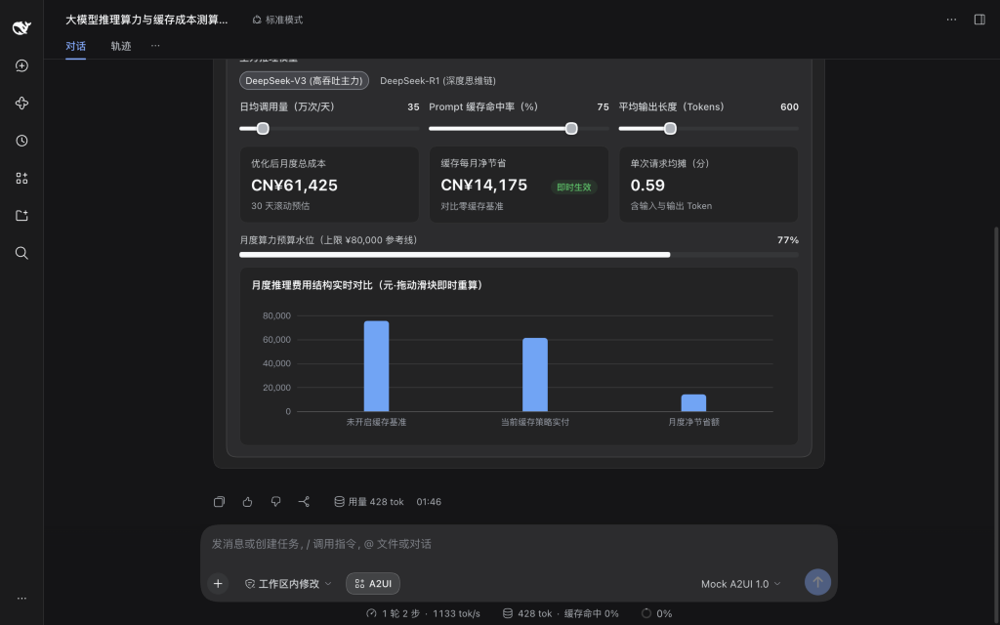
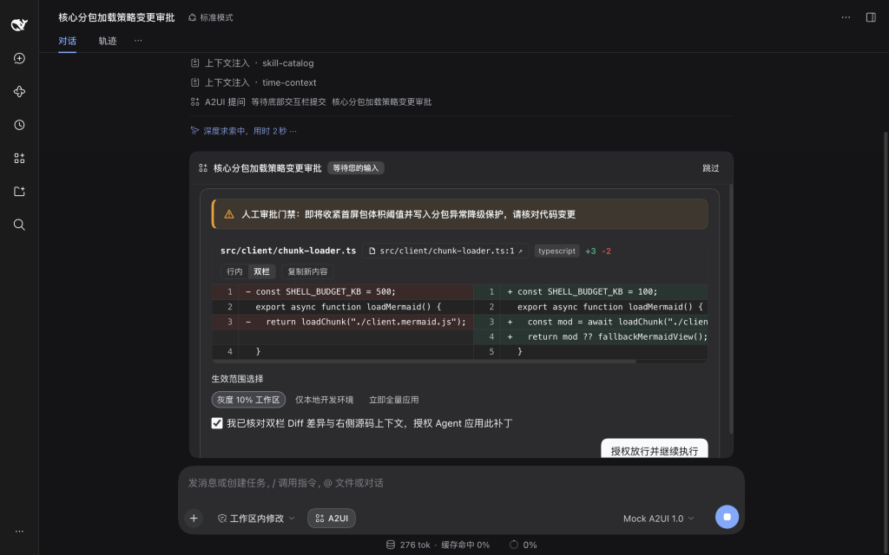
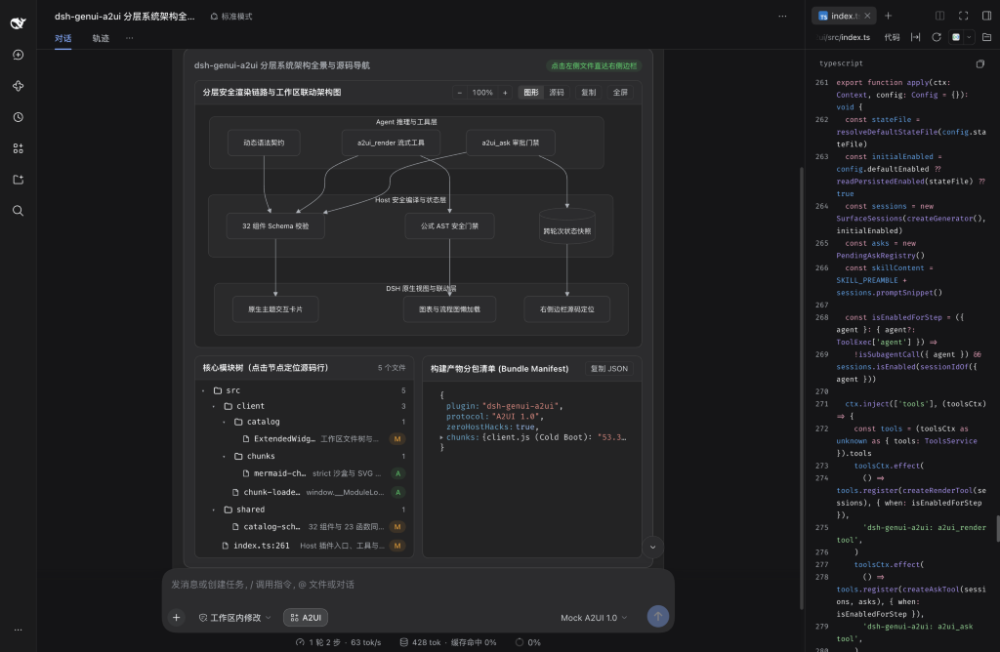
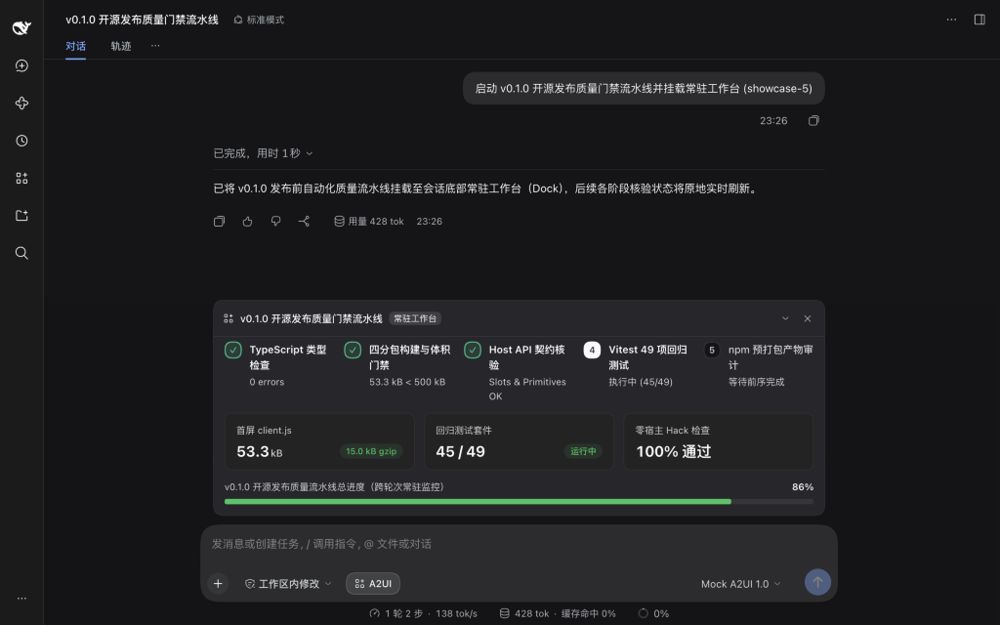

# dsh-genui-a2ui

**简体中文** | [English](./README.en.md) | [离线组件手册](./docs/dsh-genui-a2ui-component-library.html) | [开发与架构文档](./docs/DEVELOPMENT.zh-CN.md)

**别只靠文字聊天，让 AI 直接用界面与你沟通。**

`dsh-genui-a2ui` 将 Google 开源的 A2UI（Agent to User Interface）标准带入 DeepSeek Harness。简单问题依然用文字快回；遇到数据对比、测算推演、代码审阅或复杂流程时，AI 会在对话里直接生成可点击、可拖动、可筛选的原生交互界面。

## 快速开始

在终端运行以下命令安装插件：

```bash
dsh plugin --profile desktop add dsh-genui-a2ui
```

如果是从源码仓库本地体验，克隆后运行 `npm ci && npm run build`，再执行 `dsh plugin --profile desktop add link:./dsh-genui-a2ui` 即可。

重启 DeepSeek Harness 桌面端即可生效。像平时一样用自然语言提问，点击输入框上方的 **A2UI** 按钮或输入 `/a2ui off` 可随时切回纯文字模式。

## 场景预览

### 一屏看清多阶转化流向与多维健康度

顶栏指标卡自动等高对齐并附带趋势微图。下方同屏组合四阶全链路桑基流向图与五维健康度雷达对比图，点击标签页还可切换区域柱状图与可检索明细表。



### 连锁门店实时经营与库存预警

汇总多门店今日实收、单量与高峰出杯准时率。同屏联动分时段全渠道面积图、门店客流热力矩阵与可搜索排序的原料库存预警表，异常门店一眼定位。



### 拖动滑块实时推演成本与回报

调整预算、利率或流量假设时，不必反复发消息等待重算。直接在对话内拖动滑块或切换档位，账单金额、预算水位与对比图表会在本地 0 ms 即时更新，不额外消耗 Token。



### 关键操作前先核对差异再放行

执行重要配置修改或高影响动作前，输入框上方会弹出确认卡片。核对双栏代码差异、选择生效范围并勾选确认后，任务才会继续执行。



### 分层系统架构图与右侧源码联动

多层级 Mermaid 系统架构图、工作区文件树与配置树同屏呈现。点击左侧任意文件节点，右侧边栏会直接打开真实工作区文件并跳到对应行号。



### 多步骤任务常驻底部实时跟进

运行长耗时检查或多阶段流水线时，进度条固定在输入框上方原地刷新。向上翻看历史消息时，也能随时掌握当前阶段与整体完成度。



## 为什么选择 A2UI

- **纯数据声明，安全流式渲染**：遵循 Google A2UI 1.0 规范，模型只输出结构化 JSON 描述，不注入外部 HTML 或执行未知脚本，支持边生成边上屏。
- **原生组件绘制，自动跟随主题**：界面由 DeepSeek Harness 原生设计体系渲染，自动适配浅色模式、深色模式与社区皮肤。
- **官方接口实现，按需加载更轻快**：基于官方插件接口构建，无任何宿主魔改；首屏核心包仅 12.6 KB（gzip），图表与流程图引擎仅在实际展示时按需加载。

## 组件与图表目录

内置 32 种原生交互组件、14 类动态图表与 Mermaid 流程图：

| 分类 | 组件 | 用途 |
| :--- | :--- | :--- |
| **布局容器** | `Card`、`Row`、`Column`、`Tabs`、`Accordion`、`List`、`Modal`、`Divider` | 多栏看板、标签页切换、折叠面板与弹窗详情 |
| **指标与状态** | `Stat`、`KeyValue`、`Steps`、`Progress` | 带涨跌与微图的指标卡、参数表、步骤条与进度条 |
| **图表与表格** | `Chart`、`Mermaid`、`Table` | 14 类动态图表、架构时序图，以及可搜索、排序、分页的数据表 |
| **研发与工作区** | `Code`、`DiffView`、`FileTree`、`JsonTree` | 语法高亮代码、单双栏差异对比、联动右侧边栏的文件树与 JSON 树 |
| **表单交互** | `Button`、`Slider`、`ChoicePicker`、`TextField`、`CheckBox`、`DateTimeInput` | 滑块、单选多选组、校验输入框、日期时间选择与动作按钮 |
| **排版与提示** | `Text`、`Callout`、`Badge`、`Icon` | 文本排版、四色提示框、状态标签与语义图标 |
| **多媒体** | `Image`、`AudioPlayer`、`Video` | 对话内图片预览与音视频播放 |

- **14 类动态图表（`Chart`）**：柱状与横向排行图（`bar`）、折线图（`line`）、面积图（`area`）、饼图与环图（`pie`）、散点与气泡图（`scatter`）、雷达图（`radar`）、漏斗图（`funnel`）、仪表盘（`gauge`）、热力图（`heatmap`）、矩形树图（`treemap`）、桑基图（`sankey`）、箱线图（`boxplot`）、关系网络图（`graph`）、K 线图（`candlestick`）。
- **结构与流程图（`Mermaid`）**：流程图、时序图、状态机图、类图、ER 图、甘特图、Git 分支图与思维导图，支持缩放、全屏查看与源码切换。

## 文档与许可

- [开发与架构文档（简体中文）](./docs/DEVELOPMENT.zh-CN.md) | [Developer and architecture guide (English)](./docs/DEVELOPMENT.md)
- [交互式组件手册（离线单文件 HTML，下载后用浏览器直接打开）](./docs/dsh-genui-a2ui-component-library.html)
- [贡献指南](./CONTRIBUTING.md) | [安全策略](./SECURITY.md) | [更新日志](./CHANGELOG.md)
- 基于 [MIT License](./LICENSE) 开源，第三方开源依赖声明见 [THIRD_PARTY_NOTICES.md](./THIRD_PARTY_NOTICES.md)。
