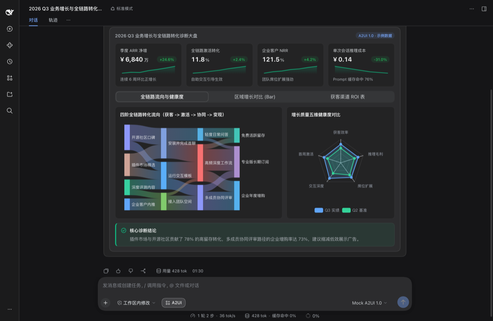

`dsh-genui-a2ui` brings Google's open A2UI 1.0 standard to DeepSeek Harness. Simple questions still get fast text replies; when plain text falls short, AI renders clickable, draggable, filterable native UI directly inside your chat.

## Ready-to-run example prompts

1. **Executive conversion and health dashboard**: `Build a quarterly growth and conversion diagnostic dashboard with four KPI cards with sparklines on top, a four-stage Sankey flow paired with a five-axis health radar chart side by side, plus tabs for regional growth bars and a searchable channel ROI table.`
2. **FinOps ARR variance waterfall & drill-down cost sunburst**: `Build a quarterly ARR variance bridge and compute cost attribution dashboard with an entity header and four sparkline KPI cards on top, a waterfall bridge with a ¥680w target reference line paired side by side with a 3-level drill-down sunburst chart, and a searchable billing summary table below.`
3. **Dual-axis combo chart, live SLO slider & change calendar heatmap**: `Build a core gateway throughput and SLO diagnostic dashboard with three radial gauges and a live slider controlling the right-axis SLO threshold line, a zoomable dual-axis combo chart (stacked traffic bars + P99 latency & miss-rate lines), a 14-day SLA tracker strip, and a production change calendar heatmap.`
4. **Multi-model 5-axis parallel coordinates benchmark**: `Compare DeepSeek-R1, DeepSeek-V3, Qwen3, Claude-4, and Llama-4 across reasoning score, TTFT latency, throughput, token cost, and pass rate using a 5-axis parallel coordinates chart paired with a radar comparison and recommended stack trade-off matrix.`
5. **Live multi-store operations dashboard**: `Create a live chain coffee store operations dashboard showing daily revenue, total orders, peak fulfillment rate, and stock alerts, paired with hourly channel area curves, a store-by-hour order heatmap, and a searchable inventory warning table.`
6. **Zero-latency LLM inference and cache simulator**: `Build a zero-latency LLM inference and prompt-cache cost calculator where I can switch models (DeepSeek-V3 vs DeepSeek-R1), drag sliders for daily call volume, prompt cache hit rate, and average output tokens, and see monthly spend, net cache savings, budget utilization, and a cost breakdown bar chart update live.`
7. **GPU tier check-cards, precision steppers & follow-up prompts**: `Build a private LLM cluster capacity and GPU tier planner using visual check-cards to switch GPU instance tiers, precision number steppers for replica count and per-pod concurrency, multi-select tags for failover zones, a hierarchical tree-select for the target service, and clickable next-step prompt cards at the bottom.`
8. **Dedicated cluster SLA strip, bordered descriptions & expandable ProTable**: `Generate a quarterly dedicated inference cluster governance workbench with a cluster health header and 20-day SLA uptime strip on top, bordered specification descriptions in the middle, and an expandable, CSV/Markdown-exportable ProTable of idle GPU optimization targets with summary totals at the bottom.`
9. **Service health topology, APM trace waterfall & log triage**: `Diagnose a checkout API P99 latency spike by combining a live health-colored service dependency DAG (including fallback bypass and retry arcs), a distributed trace waterfall tree with latency share bars, and an error stack-trace log viewer linked to workspace source files.`
10. **High-risk DDL approval gate, runbook terminal & maintenance schedule**: `Prepare an online cold-partition archival workflow for our core billing table with a switch-gated high-risk approval card, pre-flight backup verification terminal runbook, and a maintenance window Gantt schedule bar.`
11. **Architecture trade-off comparison matrix & source citations**: `Compare PostgreSQL pgvector, Milvus, and Elasticsearch for production hybrid search with a workload tier segmented switcher on top, a multi-criteria trade-off matrix highlighting the recommended stack, and clickable benchmark citations at the bottom.`
12. **HTTP API contract workbench, preset date range & radial SLO gauges**: `Build an API rate-limit and health inspection panel combining three radial SLO gauges and a preset date-range picker on top with an interactive HTTP endpoint card supporting request/response JSON trees and shell-safe cURL copy.`
13. **Incident response Kanban, cross-zone heat matrix & execution receipt**: `Summarize a multi-AZ failover drill on one screen with a three-lane action Kanban board, an incident timeline, a quarterly cross-zone P99 latency heat matrix, and a structured drill verification receipt.`
14. **Code diff approval gate**: `Suppose you are updating our production gateway canary weight from 5% to 20% and adding a circuit-breaker timeout. Pause with a review card showing the split config diff, target cluster selector, and auto-rollback switch for my confirmation before proceeding.`
15. **Workspace architecture diagram and source explorer**: `Analyze the architecture of this workspace, render a layered Mermaid diagram alongside a clickable file tree and config JSON inspector so I can open any file directly in the right sidebar.`
16. **Persistent bottom task tracker**: `Pin a five-stage release verification tracker above the chat input showing step status and overall completion percentage across typecheck, bundle build, host API check, test suite, and tarball audit.`
17. **Market candlestick and volatility distribution**: `Create a 10-day market review dashboard combining a sentiment gauge with a daily OHLC candlestick chart and a sector return boxplot side by side.`
18. **Incident triage accordion and detail modal**: `Generate a layered API latency incident report using collapsible accordions for root-cause summary, key-value metrics, and mitigation steps, plus a modal button to inspect full slow-query details.`

## Toggle and slash commands

- Click the **A2UI** button below the chat input box anytime to switch between generative UI mode and plain text mode.
- Slash commands: type `/a2ui off` to pause UI generation (removes tools, prompt section, and skill catalog entry for zero system prompt overhead), `/a2ui on` to re-enable it, or `/a2ui status` to check the current state.

## Built-in 57 native components and chart catalog

| Category | Components | Purpose |
| :--- | :--- | :--- |
| **Layout & entity headers** | `Card`, `Row`, `Column`, `Grid`, `Tabs`, `Accordion`, `List`, `Modal`, `Divider`, `EntityHeader` | Responsive multi-row CSS grids, multi-column dashboards, tabs, collapsible panels, modals, and B2B object headers |
| **Metrics, SLOs & outcomes** | `Stat`, `MetricRing`, `Tracker`, `KeyValue` (bordered Descriptions), `Steps`, `Timeline`, `Schedule`, `Progress`, `Result` | KPI cards, radial rings, Tremor SLA/category bars, bordered descriptions, timelines, Gantt schedules, and outcome receipts |
| **Charts, topology & ProTable** | `Chart`, `ServiceGraph`, `Mermaid`, `Comparison`, `Matrix`, `Table` (expandable ProTable), `Tree`, `Kanban` | 19 chart kinds, live health DAGs, trade-off & heat matrices, expandable/exportable ProTables, org/trace trees, and Kanban boards |
| **DevOps, APIs & risk gates** | `Code`, `Terminal`, `ApiEndpoint`, `ApprovalCard`, `DiffView`, `LogViewer`, `FileTree`, `JsonTree`, `SourceList` | Code blocks, runbook terminals, HTTP API workbenches, risk approval gates, diffs, logs, file trees, and citations |
| **Forms & prompt cards** | `Button`, `NumberInput`, `MultiSelect`, `DateRange`, `TreeSelect`, `CheckCard`, `Segmented`, `Select`, `Switch`, `Slider`, `ChoicePicker`, `TextField`, `CheckBox`, `DateTimeInput` | Precision steppers, multi-tag selects, preset date ranges, hierarchical tree selects, visual check/prompt cards, switches, sliders, and validated inputs |
| **Typography and alerts** | `Text`, `Callout`, `Badge`, `Icon` | Rich text, color-coded callouts, status badges, and semantic icons |
| **Media** | `Image` (native lightbox), `AudioPlayer`, `Video` | Click-to-zoom lightbox image previews, audio players, and video playback |

- **19 interactive charts (`Chart`)**: Vertical and horizontal ranking bars (`bar`), `line`, `area`, dual-axis bar + line (`combo`), variance bridge (`waterfall`), donut and pie (`pie`), bubble and `scatter`, `radar`, multi-axis `parallel`, `funnel`, `gauge`, `heatmap`, daily `calendar` heatmap, `treemap`, drill-down `sunburst`, `sankey`, `boxplot`, network (`graph`), and `candlestick`, plus `referenceLine` threshold markers.
- **Architecture and flow diagrams (`Mermaid`)**: Flowcharts, sequence diagrams, state machines, class diagrams, ER diagrams, Gantt charts, Git graphs, and mindmaps with `10%–2000%` lossless vector zoom, drag-to-pan, fullscreen view, and source toggle.
- **Repository and full documentation**: [github.com/Geekhyt/dsh-genui-a2ui](https://github.com/Geekhyt/dsh-genui-a2ui)
