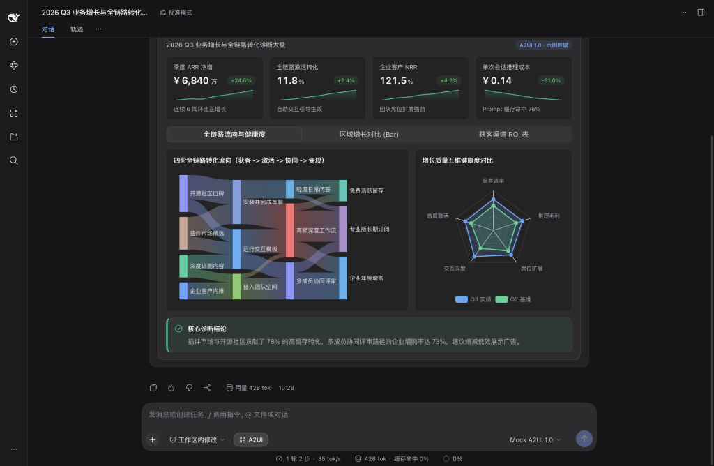

`dsh-genui-a2ui` brings Google's open A2UI 1.0 standard to DeepSeek Harness. Simple questions still get fast text replies; when plain text falls short, AI renders clickable, draggable, filterable native UI directly inside your chat.

## Ready-to-run example prompts

1. **Executive conversion and health dashboard**: `Build a quarterly growth and conversion diagnostic dashboard with four KPI cards with sparklines on top, a four-stage Sankey flow paired with a five-axis health radar chart side by side, plus tabs for regional growth bars and a searchable channel ROI table.`
2. **Live multi-store operations dashboard**: `Create a live chain coffee store operations dashboard showing daily revenue, total orders, peak fulfillment rate, and stock alerts, paired with hourly channel area curves, a store-by-hour order heatmap, and a searchable inventory warning table.`
3. **Zero-latency cost and margin simulator**: `Build an interactive AI inference cost and margin calculator where I can drag sliders for daily active users, cost per call, and cache hit rate, switch pricing tiers, and see monthly spend, gross margin, and a cost breakdown bar chart update live.`
4. **Code diff approval gate**: `Suppose you are updating our production gateway canary weight from 5% to 20% and adding a circuit-breaker timeout. Pause with a review card showing the split config diff, target cluster selector, and auto-rollback checkbox for my confirmation before proceeding.`
5. **Workspace architecture diagram and source explorer**: `Analyze the architecture of this workspace, render a layered Mermaid diagram alongside a clickable file tree and config JSON inspector so I can open any file directly in the right sidebar.`
6. **Persistent bottom task tracker**: `Pin a five-stage release verification tracker above the chat input showing step status and overall completion percentage across typecheck, bundle build, host API check, test suite, and tarball audit.`

## Toggle and slash commands

- Click the **A2UI** button below the chat input box anytime to switch between generative UI mode and plain text mode.
- Slash commands: type `/a2ui off` to pause UI generation (zero system prompt overhead), or `/a2ui on` to re-enable it.

## Built-in 32 native components and chart catalog

| Category | Components | Purpose |
| :--- | :--- | :--- |
| **Layout containers** | `Card`, `Row`, `Column`, `Tabs`, `Accordion`, `List`, `Modal`, `Divider` | Multi-column dashboards, tabbed views, collapsible panels, and modal details |
| **Metrics and status** | `Stat`, `KeyValue`, `Steps`, `Progress` | KPI cards with deltas and sparklines, spec grids, step timelines, and progress bars |
| **Charts and tables** | `Chart`, `Mermaid`, `Table` | 14 interactive chart types, architecture diagrams, and searchable, sortable, paginated tables |
| **Code and workspace** | `Code`, `DiffView`, `FileTree`, `JsonTree` | Highlighted code, unified or split diffs, clickable workspace file trees, and JSON inspectors |
| **Form controls** | `Button`, `Slider`, `ChoicePicker`, `TextField`, `CheckBox`, `DateTimeInput` | Sliders, single or multi-select chips, validated inputs, date pickers, and action buttons |
| **Typography and alerts** | `Text`, `Callout`, `Badge`, `Icon` | Rich text, color-coded callouts, status badges, and semantic icons |
| **Media** | `Image`, `AudioPlayer`, `Video` | Inline image previews, audio players, and video playback |

- **14 interactive charts (`Chart`)**: Vertical and horizontal ranking bars (`bar`), `line`, `area`, donut and pie (`pie`), bubble and `scatter`, `radar`, `funnel`, `gauge`, `heatmap`, `treemap`, `sankey`, `boxplot`, network (`graph`), and `candlestick`.
- **Architecture and flow diagrams (`Mermaid`)**: Flowcharts, sequence diagrams, state machines, class diagrams, ER diagrams, Gantt charts, Git graphs, and mindmaps with zoom, fullscreen view, and source toggle.
- **Repository and full documentation**: [github.com/Geekhyt/dsh-genui-a2ui](https://github.com/Geekhyt/dsh-genui-a2ui)
