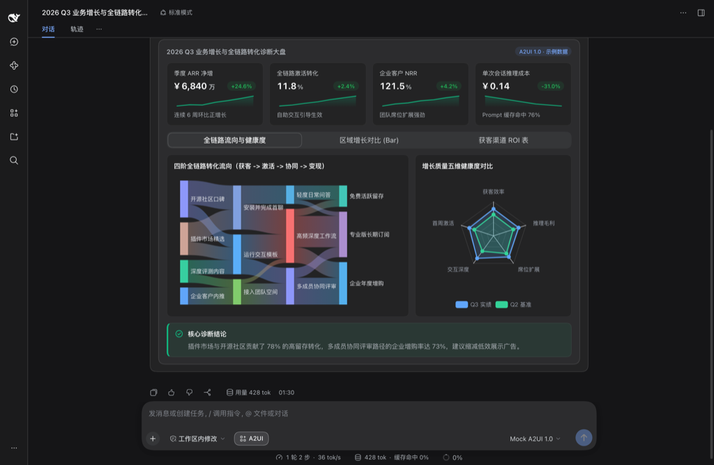

`dsh-genui-a2ui` 将 Google 开源的 A2UI 1.0 标准带入 DeepSeek Harness。简单问题依然用文字快回；遇到数据对比、测算推演、代码审阅或复杂流程时，AI 会在对话里直接生成可点击、可拖动、可筛选的原生交互界面。

## 可直接复制体验的提示词

1. **转化漏斗与健康度大盘**：`帮我做一份季度业务增长与全链路转化诊断看板，包含四个带趋势微图的核心指标卡，下方同屏放一张四阶桑基流向图和一张五维健康度雷达对比图，再用标签页放区域增长柱状图和可搜索的渠道明细表。`
2. **连锁门店实时经营看板**：`模拟一份连锁咖啡品牌今日实时经营仪表盘，顶部展示今日实收、总单量、高峰出杯准时率和缺货预警数，下方联动分时段全渠道面积图、各门店分时段单量热力图，以及可搜索排序的原料库存预警表。`
3. **零延迟算力与缓存成本测算器**：`做一个大模型推理算力与缓存成本实时测算沙盘，支持单选切换主力推理模型（DeepSeek-V3 / R1），并用滑块调节日均调用量、Prompt 缓存命中率和平均输出长度，本地实时算出月度总成本、缓存净节省额、预算水位与费用对比柱状图。`
4. **多规格卡片选型与步进容量规划**：`做一个私有化大模型集群容量与规格选型工作台，用卡片组切换 GPU 机型档位，配合步进数字框调节副本数与单副本并发、多选框配置容灾可用区、级联树绑定目标微服务，并在底部给出下一步压测追问建议卡。`
5. **专属集群健康度与可展开 ProTable**：`生成核心业务专属推理集群的季度巡检与算力治理台，顶部放集群健康概览头和 20 日 SLA 可用性时序条，中部用带边框描述表列出工单规格，底部用支持行内展开详情、导出与汇总的 ProTable 列出闲置实例优化清单。`
6. **微服务健康拓扑与调用链瀑布排障**：`排查线上支付结算接口 P99 延迟突增问题，同屏展示含降级旁路与重试环路的微服务实时健康拓扑图、带耗时占比条的分布式调用链瀑布树，以及关联异常堆栈日志与源码定位。`
7. **高危数据库变更审批与排期甘特条**：`准备对核心账单表执行历史冷分区在线归档，请生成带二次确认开关的高风险变更审批卡、前置快照校验终端手册，以及凌晨维护窗口甘特排期条。`
8. **技术选型对比矩阵与溯源证据卡**：`对比 PostgreSQL pgvector、Milvus 与 Elasticsearch 三种生产级混合检索方案，顶部支持分段切换评估负载规模，中部展示带推荐标记的多维权衡矩阵，底部附上官方文档与压测基准溯源引用。`
9. **接口契约调试台、时间窗与圆环水位**：`生成支付核心网关限流扩容接口的联调与健康诊断面板，顶部展示三个圆环水位仪表和快捷日期区间选择器，下方展示支持一键复制安全 cURL、请求体与响应树的接口契约调试卡。`
10. **应急协同看板、热力矩阵与操作回执**：`汇总一次跨可用区流量容灾演练复盘，同屏组合三泳道任务跟进看板、关键动作时间轴、跨可用区季度延迟热力矩阵，以及最终演练达标回执单。`
11. **代码差异核对与确认单**：`假设你要把线上网关的灰度权重从 5% 调到 20% 并新增超时熔断参数，请先弹出交互确认卡片展示双栏配置差异、生效集群下拉选择和自动回滚开关，等我确认后再继续。`
12. **当前工作区架构图与源码联动**：`梳理当前工作区项目的核心模块分层，画一张多层 Mermaid 架构图，并附上关键源码文件树和核心配置树，方便我点击直接在右侧打开对应文件。`
13. **底部常驻多阶段进度栏**：`把一个包含类型检查、分包构建、契约核验、回归测试和打包审计五步的发布流水线进度条固定在输入框上方，展示各阶段状态与整体完成百分比。`
14. **量化行情 K 线与波动分布**：`模拟一份科技指数近 10 个交易日的量化复盘看板，同屏组合情绪水位仪表盘、日 K 线图以及各细分板块涨跌幅箱线分布图。`
15. **故障排查折叠手风琴与详情弹窗**：`生成一份线上网关延迟突增的分级排查卡片，用折叠手风琴分层收纳根因摘要、关键指标键值表与回滚预案，并附带一个点击弹出慢查询详情的弹窗按钮。`

## 模式切换与指令

- 点击对话输入框左下方的 **A2UI** 按钮，可随时在生成式界面模式与纯文字模式之间切换。
- 支持斜杠指令：输入 `/a2ui off` 关闭界面生成（同步移除工具、提示词与技能目录，零额外系统提示词消耗），输入 `/a2ui on` 重新开启，输入 `/a2ui status` 查看当前状态。

## 内置 57 种原生组件与图表体系

| 分类 | 组件 | 用途 |
| :--- | :--- | :--- |
| **布局与对象头** | `Card`、`Row`、`Column`、`Grid`、`Tabs`、`Accordion`、`List`、`Modal`、`Divider`、`EntityHeader` | 响应式多行等宽网格、多栏看板、标签页、折叠面板、弹窗详情与 B 端业务对象概览头 |
| **指标、监控与结果** | `Stat`、`MetricRing`、`Tracker`、`KeyValue`（含表格边框模式）、`Steps`、`Timeline`、`Schedule`、`Progress`、`Result` | 指标卡、圆环水位、Tremor 可用性条、带边框描述列表、步骤条、时间线、甘特排期条与操作回执单 |
| **图表、拓扑与矩阵** | `Chart`、`ServiceGraph`、`Mermaid`、`Comparison`、`Matrix`、`Table`（ProTable，支持行内展开详情）、`Tree`、`Kanban` | 14 类图表、实时健康拓扑、方案对比、热力矩阵、支持展开抽屉/导出/多选的 ProTable、通用层级/调用链树与看板 |
| **研发、接口与风控** | `Code`、`Terminal`、`ApiEndpoint`、`ApprovalCard`、`DiffView`、`LogViewer`、`FileTree`、`JsonTree`、`SourceList` | 代码高亮、运维命令卡、API 调试台、高危变更审批门禁、差异对比、日志台、文件树与溯源引用 |
| **表单与对话建议** | `Button`、`NumberInput`、`MultiSelect`、`DateRange`、`TreeSelect`、`CheckCard`、`Segmented`、`Select`、`Switch`、`Slider`、`ChoicePicker`、`TextField`、`CheckBox`、`DateTimeInput` | 步进数字框、多选标签下拉、日期区间快捷选择、级联树选择、选项卡片组/对话追问建议卡、分段、下拉、开关、滑块与校验输入框 |
| **排版与提示** | `Text`、`Callout`、`Badge`、`Icon` | 文本排版、四色提示框、状态标签与语义图标 |
| **多媒体** | `Image`（原生灯箱放大）、`AudioPlayer`、`Video` | 支持点击大图灯箱预览的图片与对话内音视频播放 |

- **14 类动态图表（`Chart`）**：柱状与横向排行图（`bar`）、折线图（`line`）、面积图（`area`）、饼图与环图（`pie`）、散点与气泡图（`scatter`）、雷达图（`radar`）、漏斗图（`funnel`）、仪表盘（`gauge`）、热力图（`heatmap`）、矩形树图（`treemap`）、桑基图（`sankey`）、箱线图（`boxplot`）、关系网络图（`graph`）、K 线图（`candlestick`）。
- **结构与流程图（`Mermaid`）**：流程图、时序图、状态机图、类图、ER 图、甘特图、Git 分支图与思维导图，支持 `10%–2000%` 矢量无损缩放、按住拖拽漫游、全屏查看与源码切换。
- **项目主页与完整文档**：[github.com/Geekhyt/dsh-genui-a2ui](https://github.com/Geekhyt/dsh-genui-a2ui)
