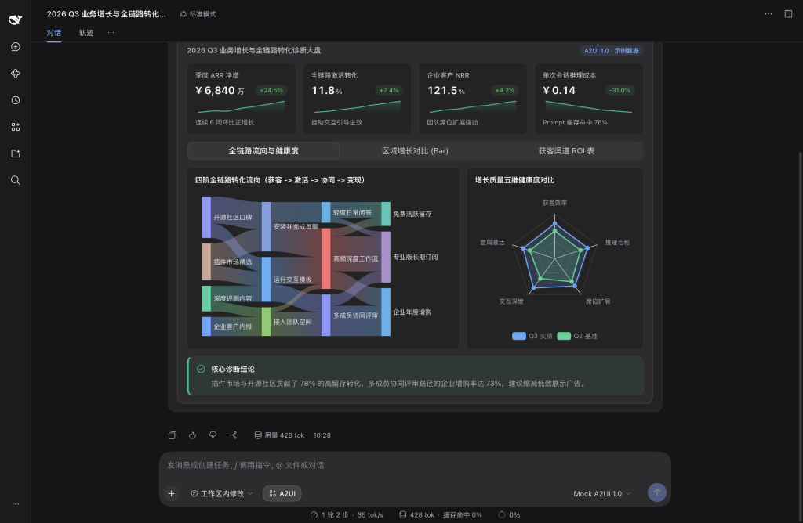

`dsh-genui-a2ui` 将 Google 开源的 A2UI 1.0 标准带入 DeepSeek Harness。简单问题依然用文字快回；遇到数据对比、测算推演、代码审阅或复杂流程时，AI 会在对话里直接生成可点击、可拖动、可筛选的原生交互界面。

## 可直接复制体验的提示词

1. **转化漏斗与健康度大盘**：`帮我做一份季度业务增长与全链路转化诊断看板，包含四个带趋势微图的核心指标卡，下方同屏放一张四阶桑基流向图和一张五维健康度雷达对比图，再用标签页放区域增长柱状图和可搜索的渠道明细表。`
2. **连锁门店实时经营看板**：`模拟一份连锁咖啡品牌今日实时经营仪表盘，顶部展示今日实收、总单量、高峰出杯准时率和缺货预警数，下方联动分时段全渠道面积图、各门店分时段单量热力图，以及可搜索排序的原料库存预警表。`
3. **零延迟参数测算器**：`做一个 SaaS 与推理成本实时测算器，让我能用滑块调节日活规模、单次推理单价和缓存命中率，并用单选切换套餐档位，本地实时算出月度总成本、毛利率和成本结构对比柱状图。`
4. **代码差异核对与确认单**：`假设你要把线上网关的灰度权重从 5% 调到 20% 并新增超时熔断参数，请先弹出交互确认卡片展示双栏配置差异、生效集群单选和自动回滚勾选框，等我确认后再继续。`
5. **当前工作区架构图与源码联动**：`梳理当前工作区项目的核心模块分层，画一张多层 Mermaid 架构图，并附上关键源码文件树和核心配置树，方便我点击直接在右侧打开对应文件。`
6. **底部常驻多阶段进度栏**：`把一个包含类型检查、分包构建、契约核验、回归测试和打包审计五步的发布流水线进度条固定在输入框上方，展示各阶段状态与整体完成百分比。`

## 模式切换与指令

- 点击对话输入框左下方的 **A2UI** 按钮，可随时在生成式界面模式与纯文字模式之间切换。
- 支持斜杠指令：输入 `/a2ui off` 关闭界面生成（零额外系统提示词消耗），输入 `/a2ui on` 重新开启。

## 内置 32 种原生组件与图表体系

| 分类 | 组件 | 用途 |
| :--- | :--- | :--- |
| **布局容器** | `Card`、`Row`、`Column`、`Tabs`、`Accordion`、`List`、`Modal`、`Divider` | 多栏看板、标签页切换、折叠面板与弹窗详情 |
| **指标与状态** | `Stat`、`KeyValue`、`Steps`、`Progress` | 带涨跌与微图的指标卡、参数表、步骤条与进度条 |
| **图表与表格** | `Chart`、`Mermaid`、`Table` | 14 类动态图表、架构时序图，以及可搜索、排序、分页的数据表 |
| **研发与工作区** | `Code`、`DiffView`、`FileTree`、`JsonTree` | 语法高亮代码、单双栏差异对比、联动右侧边栏的文件树与 JSON 树 |
| **表单交互** | `Button`、`Slider`、`ChoicePicker`、`TextField`、`CheckBox`、`DateTimeInput` | 滑块、单选多选组、校验输入框、日期时间选择与动作按钮 |
| **排版与提示** | `Text`、`Callout`、`Badge`、`Icon` | 文本排版、四色提示框、状态标签与语义图标 |
| **多媒体** | `Image`、`AudioPlayer`、`Video` | 对话内图片预览与音视频播放 |

- **14 类动态图表（`Chart`）**：柱状与横向排行图（`bar`）、折线图（`line`）、面积图（`area`）、饼图与环图（`pie`）、散点与气泡图（`scatter`）、雷达图（`radar`）、漏斗图（`funnel`）、仪表盘（`gauge`）、热力图（`heatmap`）、矩形树图（`treemap`）、桑基图（`sankey`）、箱线图（`boxplot`）、关系网络图（`graph`）、K 线图（`candlestick`）。
- **结构与流程图（`Mermaid`）**：流程图、时序图、状态机图、类图、ER 图、甘特图、Git 分支图与思维导图，支持缩放、全屏查看与源码切换。
- **项目主页与完整文档**：[github.com/Geekhyt/dsh-genui-a2ui](https://github.com/Geekhyt/dsh-genui-a2ui)
