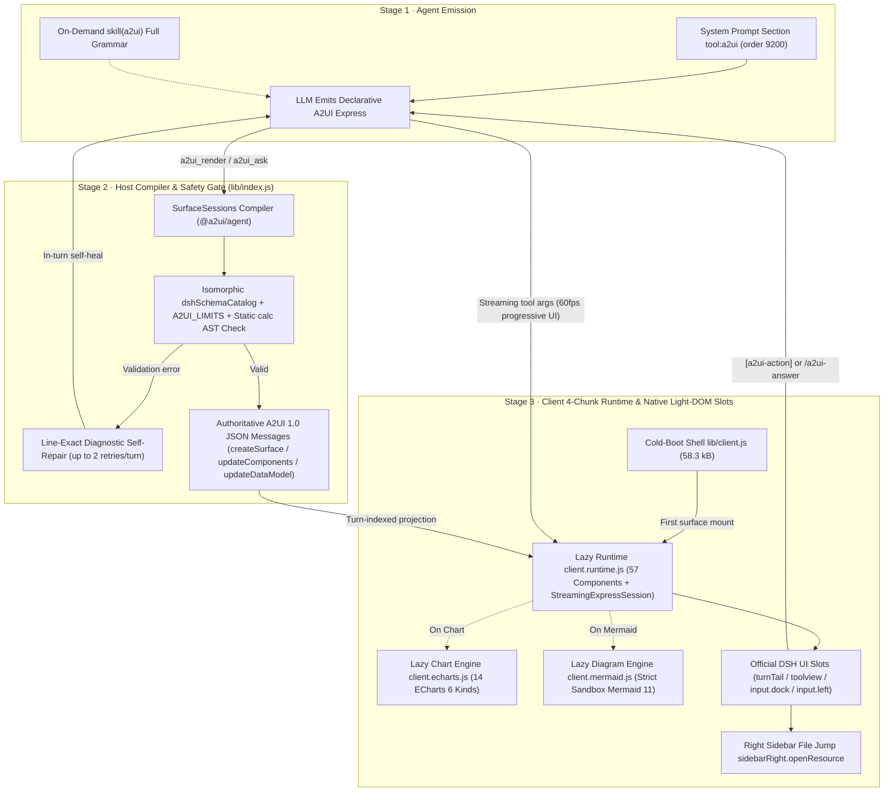

# Developer & Architecture Guide (`dsh-genui-a2ui`)

**English** | [简体中文](./DEVELOPMENT.zh-CN.md) | [Back to Product README](../README.en.md)

This document covers the technical architecture, **Google A2UI 1.0** protocol compliance, **DeepSeek Harness (DSH)** official extension seams, bundle code-splitting budgets, complete **A2UI Express DSL** contracts, and local verification workflows for `dsh-genui-a2ui`.

---

## 1. Architectural Overview

`dsh-genui-a2ui` operates as a three-stage pipeline strictly separated across the Host (Node.js / Cordis) and Client (Browser / React) boundary:

1. **Agent Emission (`A2UI Express`)** — When `a2ui` is enabled, the Host injects a compact system-prompt section (`tool:a2ui`, `order: 9200` to preserve built-in KV-cache prefixes) and registers the on-demand `a2ui` skill. Models invoke `a2ui_render` or `a2ui_ask` using concise A2UI Express syntax.
2. **Host Validation & Self-Repair (`@a2ui/agent` + Zod)** — `SurfaceSessions` compiles A2UI Express against the isomorphic `dshSchemaCatalog` (`src/shared/catalog-schema.ts`), enforces payload/depth/formula safety caps (`A2UI_LIMITS`), and returns pinpoint line diagnostics on invalid tags or props so the model can self-repair within the same turn (up to `2` retries).
3. **Client Streaming & Native Light-DOM Rendering (`@a2ui/react`)** — In the browser, `StreamingExpressSession` progressively parses partial tool-call arguments at 60fps while chunks arrive, then switches to authoritative Host-compiled A2UI JSON messages (`createSurface`, `updateComponents`, `updateDataModel`) once tool execution completes.



---

## 2. Six Pillars of Google A2UI 1.0 Compliance

`dsh-genui-a2ui` adheres strictly to the **A2UI (Agent-to-User Interface) 1.0** specification without private protocol forks:

1. **Data, Not Code (Security by Design)** — Agents never emit executable HTML, JavaScript, or `iframe` documents. Only pure declarative JSON messages cross the Host-Client boundary, eliminating XSS and arbitrary script execution by construction.
2. **Trusted Client Catalog** — Only the **57 components** and **23 functions** registered in `dshSchemaCatalog` can be instantiated. Unknown components or malformed arguments are rejected at compile time and render time.
3. **LLM-Friendly Flat Streaming Graph** — Container composition uses flat component maps with `ChildSchema` ID references rather than deeply nested JSX trees, enabling 60fps token-by-token streaming and surgical in-place updates via `surface("id", update=true)`.
4. **Structure · State · Render Separation** — UI topology (`components`), JSON Pointer reactive state (`$/paths`), and host React widgets are decoupled.
5. **Thin UI, Thick Agent** — Deterministic scalar math (`calc`), conditional formatting (`cond`), and input checks (`?checks`) execute locally in `0ms`; open-ended reasoning, multi-row schedule generation, live queries, and external side effects round-trip to the Agent via `[a2ui-action]` or `a2ui_ask`.
6. **Host-Native Experience** — Zero Shadow DOM and zero `iframe` isolation tax. Components render directly in Light DOM with DSH's shared primitives and `--dsw-*` CSS tokens, inheriting light/dark themes and community skins automatically.

---

## 3. Zero-Hack DeepSeek Harness Integration

`dsh-genui-a2ui` relies exclusively on documented DSH Host and Client extension APIs — zero undocumented DOM queries, zero private Electron IPC hooks, and zero monkey-patches:

| Layer | Official DSH Extension Seam | Usage in `dsh-genui-a2ui` |
| :--- | :--- | :--- |
| **Host Services** | Cordis `tools`, `skills`, `commands`, `systemPrompt` | Registers `a2ui_render`, `a2ui_ask`, `skill("a2ui")`, `/a2ui`, `/a2ui-answer`, and `tool:a2ui` prompt guidance. |
| **Client UI Slots** | `tool.call.toolview`, `conversation.chat.turnTail`, `conversation.input.dock`, `conversation.input.left`, `conversation.user.text.node` | Renders inline streaming cards, turn-tail spotlight deliverables, persistent docks, blocking approval wizards, the composer toggle pill, and `[a2ui-action]` receipt chips. |
| **Conversation Projections** | `uiConversation.events.register`, `uiConversation.userText.register` | Projects settled `a2ui_render` surfaces into replay-safe, fork-safe turn metadata and formats `[a2ui-action]` user messages. |
| **Shared UI Primitives** | `@deepseek-ai/dsh-client-ui-primitives` | Reuses 27 native host exports (`Switch`, `SegmentedControl`, `HoverCard`, `StateDot`, `ImageLightbox`, `FileTypeIcon`, `PathLabel`, `LinkIconRegular`, `JsonTree`, etc.) and `--dsw-*` semantic design tokens. |
| **Workspace Sidebar** | `@deepseek-ai/dsh-client-ui-sidebar-right` | Calls `sidebarRight.openResource` from `FileTree`, `DiffView`, `Code`, `LogViewer`, and `SourceList` to jump directly to workspace files and 1-based line numbers. |
| **Client Code Splitting** | `window.__ModuleLoader__.load({ id: "dsh-genui-a2ui", entry })` | Loads heavy runtime, ECharts, and Mermaid chunks strictly on demand. |

### 4-Chunk On-Demand Bundle Architecture

| Bundle Target | Raw Size | Gzip Size | Role & Load Trigger |
| :--- | :--- | :--- | :--- |
| `lib/client.js` | **`58.3 kB`** | **`16.5 kB`** | Cold-boot shell: registers UI Slots, bilingual chrome, empty-session toast feedback, and composer pill (enforced by `< 100 kB` build & test gate). |
| `lib/client.runtime.js` | `1.28 MB` | ~`345 kB` | Loaded on first A2UI surface mount (`@a2ui/react`, 57-component catalog, TanStack Table, React Aria). |
| `lib/client.echarts.js` | `790.7 kB` | `261.9 kB` | Loaded only when a surface renders `Chart` (ECharts 6 modular registration for 14 chart kinds). |
| `lib/client.mermaid.js` | `3.51 MB` | ~`943 kB` | Loaded only when a surface renders `Mermaid` (Mermaid 11 under `securityLevel: "strict"` + SVG sanitizer + LRU-64 cache). |
| `lib/index.js` | `726.1 kB` | `198.1 kB` | Self-contained Host ESM bundle (`@a2ui/agent` + Zod catalog) — ships with zero runtime `dependencies`. |

---

## 4. Surface Placement Modes & Safety Limits

### Placement Modes

| Placement | Invocation | DSH UI Slot | Lifecycle |
| :--- | :--- | :--- | :--- |
| **Spotlight** *(default)* | `a2ui_render({ ui, placement: "answer" })` | `conversation.chat.turnTail` | Rendered at turn tail; interactive on latest turn, snapshotted read-only when superseded in later turns. |
| **Inline** | `a2ui_render({ ui, placement: "inline" })` | `tool.call.toolview` | Compact summary embedded inside the tool call step row (streams progressively at 60fps while generating). |
| **Persistent Dock** | `a2ui_render({ ui, placement: "dock" })` | `conversation.input.dock` | Pinned above the chat input across turns; updated in place via `surface("id", update=true)`. |
| **Blocking Ask** | `a2ui_ask({ ui, title })` | `conversation.input.dock` + `tool.call.toolview` | Suspends the active tool call inside the current turn until settled via `/a2ui-answer` (`answered` or `skipped`). |

### Host Safety Caps (`A2UI_LIMITS`)

- `maxUiChars`: `64,000` characters per tool call
- `maxSurfacesPerCall`: `8` surfaces
- `maxComponentsPerSurface`: `250` flat component nodes
- `maxDataModelBytes`: `256,000` UTF-8 bytes
- `maxRepairsPerTurn`: `2` compiler diagnostic self-healing retries per turn

---

## 5. Complete A2UI Express DSL Reference (57 Components)

Every surface begins with `surface("snake_id")` (or `surface("snake_id", update=true)` for incremental updates) and assigns one root component to `root = ...`. Mutable state belongs in JSON Pointer paths (`$/foo = 42`); reactive expressions belong in local identifiers (`total = calc(...)`), never assigned to `$/paths`.

### Layout, Grids & Entity Headers (10)

| Component | Express DSL Signature | Technical Notes |
| :--- | :--- | :--- |
| `Card` | `Card(child)` | Surface container card using `--dsw-*` border & background tokens. |
| `Column` | `Column([c1, c2, ...], align?, justify?)` | Vertical flex stack; direct children accept numeric `weight`. |
| `Row` | `Row([c1, c2, ...], justify?, align?)` | Horizontal flex row (`justify`: `"spaceBetween" \| "start" \| "center" \| "end"`). |
| `Grid` | `Grid([c1, c2, ...], columns?=3, gap?="sm"\|"md"\|"lg")` | Responsive multi-row equal-width CSS Grid container (falls back to 1 column on mobile). |
| `Tabs` | `Tabs([{ title, child }, ...])` | Preserves surface `dataModel` bindings across tab switches. |
| `Accordion` | `Accordion([{ title, subtitle?, badge?, open?, child }, ...], multiple?)` | Collapsible disclosure container backed by flat `ChildSchema` IDs. |
| `List` | `List([c1, c2, ...], direction?, align?)` | Vertical or horizontal semantic list. |
| `Modal` | `Modal(trigger=Button(...), content=Column([...]))` | Accessible modal dialog overlay. |
| `Divider` | `Divider(axis?)` | Horizontal or vertical divider line. |
| `EntityHeader` | `EntityHeader(title, subtitle?, avatarText?, status?, statusLabel?, badge?, tags?, metrics?, actionLabel?, action?)` | B2B business object header (tenant/cluster/service/ticket) powered by host `StateDot`. |

### Typography & Advisories (4)

| Component | Express DSL Signature | Technical Notes |
| :--- | :--- | :--- |
| `Text` | `Text(text, variant?="body"\|"caption"\|"h1".."h5")` | Full GFM Markdown renderer bound to static strings or `$/paths`. |
| `Callout` | `Callout(title, message?, tone?="info"\|"success"\|"warning"\|"danger", collapsible?, child?)` | Semantic banner with optional collapsible body and nested `ChildSchema`. |
| `Badge` | `Badge(label, tone?="neutral"\|"info"\|"success"\|"warning"\|"danger"\|"outline"\|"solid")` | Semantic pill badge. |
| `Icon` | `Icon(name)` | Vector icon mapped to standard A2UI icon names. |

### Metrics, SLOs, Timelines & Outcomes (9)

| Component | Express DSL Signature | Technical Notes |
| :--- | :--- | :--- |
| `Stat` | `Stat(label, value, delta?, trend?="up"\|"down"\|"neutral", caption?, spark?)` | KPI card with unit split, trend badge, and inline SVG `spark` array (`[10, 14, 19]`). |
| `MetricRing` | `MetricRing(label, value, max?=100, unit?, sublabel?, tone?="auto", size?=88)` | Radial gauge ring with automatic threshold coloring (`tone="auto"`). |
| `Tracker` | `Tracker(data, title?, summary?, mode?="uptime"\|"category")` | Tremor SLA uptime strip (with host `HoverCard` tooltips) & multi-segment category bar. |
| `KeyValue` | `KeyValue(items, title?, columns?=1..3, copyable?, bordered?=false)` | AntD `<Descriptions>` with `bordered=true` table mode and item-level `span: 1..3`. |
| `Steps` | `Steps(items, current?, direction?="vertical"\|"horizontal", title?)` | Items: `{ title, description?, status?: "done"\|"active"\|"pending"\|"error", meta? }`. |
| `Timeline` | `Timeline(items, title?, badge?)` | Chronological stream supporting collapsible `detail` and nested `child` components. |
| `Schedule` | `Schedule(items, title?, range?, now?, action?)` | Maintenance window & Gantt timeline bar with current-time marker. |
| `Progress` | `Progress(value, max?=100, label?, tone?="brand"\|"success"\|"warning"\|"danger")` | Accessible reactive progress bar. |
| `Result` | `Result(status="success"\|"info"\|"warning"\|"error"\|"empty", title, subtitle?, meta?, actionLabel?, action?, child?)` | Structured operation receipt & empty state card. |

### Charts, Topologies, Matrices, Trees & ProTables (8)

| Component | Express DSL Signature | Technical Notes |
| :--- | :--- | :--- |
| `Chart` | `Chart(kind, data, title?, xField?, yField?, seriesField?, sizeField?, stacked?, horizontal?, zoom?, height?, action?)` | 14 kinds: `"bar" \| "line" \| "area" \| "pie" \| "scatter" \| "radar" \| "funnel" \| "gauge" \| "heatmap" \| "treemap" \| "sankey" \| "boxplot" \| "graph" \| "candlestick"`. |
| `ServiceGraph` | `ServiceGraph(nodes, edges?, title?, direction?="LR"\|"TB", action?)` | Zero-dependency health-colored DAG with upstream/downstream highlighting. |
| `Mermaid` | `Mermaid(code, title?, caption?)` | 11 diagram families with `10%–2000%` vector zoom, drag-to-pan, and fullscreen view. |
| `Comparison` | `Comparison(options, rows, title?, action?)` | Multi-option trade-off matrix (`ok:` / `warn:` / `no:` cell prefixes & recommendation column). |
| `Matrix` | `Matrix(rows, columns, values, title?, cornerLabel?, unit?, colorScale?, showTotals?)` | Conditional-formatting heat cross-tabulation & RBAC permission matrix. |
| `Table` | `Table(rows, columns?, title?, searchable?, pageSize?, exportable?, selectable?, batchLabel?, showSummary?, expandKey?, action?)` | Enterprise `ProTable` with sort, search, pagination, density toggle, CSV/MD export, multi-select batch action, summary footer, and `expandKey` inline detail drawer. |
| `Tree` | `Tree(nodes, title?, summary?, searchable?, expandedDepth?=3, action?)` | Hierarchy & APM trace waterfall tree with `sharePct` bars and host `StateDot`. |
| `Kanban` | `Kanban(columns, title?, action?)` | Multi-lane sprint & incident triage board. |

### DevOps, APIs & Risk Gates (9)

| Component | Express DSL Signature | Technical Notes |
| :--- | :--- | :--- |
| `Code` | `Code(code, language?, lineNumbers?, title?, filePath?, line?)` | Syntax-highlighted snippet; `filePath` + `line` opens DSH's right sidebar. |
| `Terminal` | `Terminal(commands, title?, cwd?, shell?="zsh", maxHeight?)` | Runbook terminal separating `$ cmd`, `stdout`, `stderr`, and `exitCode` (copies clean command only). |
| `ApiEndpoint` | `ApiEndpoint(method, path, summary?, status?, latency?, baseUrl?, params?, headers?, requestBody?, responseBody?, action?)` | HTTP API contract workbench reusing host `JsonTree` and shell-safe `cURL` copy. |
| `ApprovalCard` | `ApprovalCard(title, summary?, severity?="high", scope?, impacts?, confirmLabel?, approveLabel?, rejectLabel?, approveAction?, rejectAction?)` | High-risk production approval gate gated by host `Switch` acknowledgement. |
| `DiffView` | `DiffView(before, after, title?, language?, mode?="unified"\|"split", filePath?, line?)` | Line diff engine with `+added/-removed` counts, Unified/Split toggle, and `filePath` jump. |
| `LogViewer` | `LogViewer(entries, title?, searchable?, defaultLevel?, maxHeight?, action?)` | Structured log & stack trace console with level pills and sidebar file links. |
| `FileTree` | `FileTree(items, title?, expandedDepth?, action?)` | Workspace file tree powered by host `FileTypeIcon` and `PathLabel`. |
| `JsonTree` | `JsonTree(data, title?, expandedDepth?, copyable?)` | Powered by `@deepseek-ai/dsh-client-ui-primitives` `JsonTree`. |
| `SourceList` | `SourceList(items, title?, action?)` | Citations & code evidence list powered by host `LinkIconRegular` and `FileTypeIcon`. |

### Form Controls, Prompt Cards & Media (17)

| Component | Express DSL Signature | Technical Notes |
| :--- | :--- | :--- |
| `Button` | `Button(child, variant?="primary"\|"default"\|"borderless", action=Event(name, context?, userMessage?))` | Sends `[a2ui-action]` or runs local `copyText`/`openUrl`; respects attached `?checks`. |
| `NumberInput` | `NumberInput(label, $/num, min?, max?, step?=1, unit?, prefix?)` | AntD `InputNumber` precision stepper bound directly to numeric `$/path`. |
| `MultiSelect` | `MultiSelect(label, options, value=$/strList, placeholder?, searchable?=true, allowCreate?=false, maxTagCount?=5)` | AntD `Select(mode="multiple"\|"tags")` with removable chips and Enter-to-create tags. |
| `DateRange` | `DateRange(label, start=$/start, end=$/end, presets?=true, enableTime?=false)` | AntD `RangePicker` with `Today / 7d / 30d / 90d` presets and span day badge. |
| `TreeSelect` | `TreeSelect(label, nodes, value=$/str, placeholder?, searchable?=true)` | AntD `TreeSelect / Cascader` displaying full hierarchical breadcrumb on trigger. |
| `CheckCard` | `CheckCard(label, options, value?=$/val, multiple?=false, columns?=3, action?)` | Dual-mode: AntD Pro `<CheckCard.Group>` when `value` is bound, or `@ant-design/x` `<Prompts>` follow-up cards when `action` is set. |
| `Segmented` | `Segmented(label, options, value=$/str)` | Delegates to host `SegmentedControl`, bound directly to scalar `$/str`. |
| `Select` | `Select(label, options, value=$/str, placeholder?, searchable?)` | Single-select dropdown (host `Menu` when ≤8 unsearchable items, searchable glass popover otherwise). |
| `Switch` | `Switch(label, $/bool, description?)` | Boolean toggle row backed by host `Switch`. |
| `Slider` | `Slider(label, min, max, $/value, steps?)` | `steps = (max - min) / stepSize`; static numeric bounds. |
| `ChoicePicker` | `ChoicePicker(label, options, value=$/list, variant?="mutuallyExclusive"\|"multipleSelection", displayStyle?="chips"\|"checkbox")` | Bound value is always an array of selected option values (`["opt_a"]`). |
| `TextField` | `TextField(label, value=$/text, variant?="shortText"\|"longText"\|"number", placeholder?)` | Supports live validation `?checks`. |
| `CheckBox` | `CheckBox(label, value=$/flag)` | Boolean data-model binding. |
| `DateTimeInput` | `DateTimeInput(label, value=$/iso, enableDate?, enableTime?, min?, max?)` | ISO 8601 string binding. |
| `Image` | `Image(url, alt?, fit?)` | Click-to-zoom preview powered by host `ImageLightbox`. |
| `AudioPlayer` | `AudioPlayer(url, description?)` | Native audio playback control. |
| `Video` | `Video(url)` | Native HTML5 video element. |

---

## 6. Client-Side Functions Reference (23 Functions)

- **Algebraic & Aggregate Math (4)**:
  - `calc(expr, vars, decimals?)`: Safe recursive-descent formula evaluator supporting `+ - * / ^ % ( ) ? : == != < <= > >= && ||` and `pow, sqrt, exp, log, ln, log10, abs, min, max, clamp, round, floor, ceil, pmt(ratePerPeriod, nper, pv)`. Validated statically at compile time (max AST depth `36`, max AST nodes `128`).
  - `cond(condition, truthy, falsy)`, `sum(items, field?)`, `avg(items, field?)`
- **Comparators & Boolean Logic (7)**:
  - `eq(a, b)` (auto-unwraps single-element `ChoicePicker` arrays), `gt(a, b)`, `lt(a, b)`, `includes(items, value)`, `and([...])`, `or([...])`, `not(x)`
- **Formatting (5)**:
  - `formatNumber(value, decimals?, grouping?)`, `formatCurrency(value, currency, decimals?, grouping?)`, `formatDate(value, format)`, `formatString(template)`, `pluralize(...)`
- **Validation (`?checks`) & Local Actions (7)**:
  - `required(value)`, `regex(value, pattern)`, `length(value, min?, max?)`, `numeric(value, min?, max?)`, `email(value)`, `copyText(text)`, `openUrl(url)`

---

## 7. Local Development, Testing & Packaging

```bash
# Install dependencies from lockfile
npm ci

# TypeScript strict check
npm run typecheck

# Build Host ESM + 4 Client CJS chunks (enforces cold-boot size gate)
npm run build

# Run all 18 Vitest suites / 75 unit, React best-practice, contract, and bundle tests
npm test

# Verify compatibility against 27 installed DeepSeek Harness.app platform exports & slots
npm run check:host-api

# Inspect npm publish tarball contents (exact 18 files)
npm pack --dry-run

# Launch isolated DSH Web profile (.dsh-dev) + scripted Mock LLM on http://127.0.0.1:18991
node scripts/dev-env.mjs setup
node scripts/dev-env.mjs serve
```

### Key Repository Layout

- `src/index.ts` — Host Cordis plugin entry (`tools`, `skills`, `commands`, `systemPrompt`)
- `src/host/` — `a2ui_render`, `a2ui_ask`, `SurfaceSessions` compiler & self-repair engine
- `src/shared/` — Isomorphic `dshSchemaCatalog` (57 components), Host/Client `wire-types.ts`, `calc` parser/evaluator, and bilingual i18n
- `src/client/index.ts` — `58.3 kB` cold-boot UI slot shell & composer toggle pill
- `src/client/dom-hooks.ts` — Sole low-level DOM / external engine lifecycle boundary (`0` `useEffect` in `.tsx` files)
- `src/client/chunks/` — On-demand entrypoints (`runtime-chunk.ts`, `echarts-chunk.ts`, `mermaid-chunk.ts`)
- `src/client/catalog/` — Light-DOM React implementations of all 57 components & 23 functions
- `build/` — `tsdown` 5-target build preset & DSH web platform externalizer
- `scripts/` — Host API contract verifier (`check-host-api.mjs`) and isolated mock dev server (`dev-env.mjs`, `mock-llm.mjs`)
