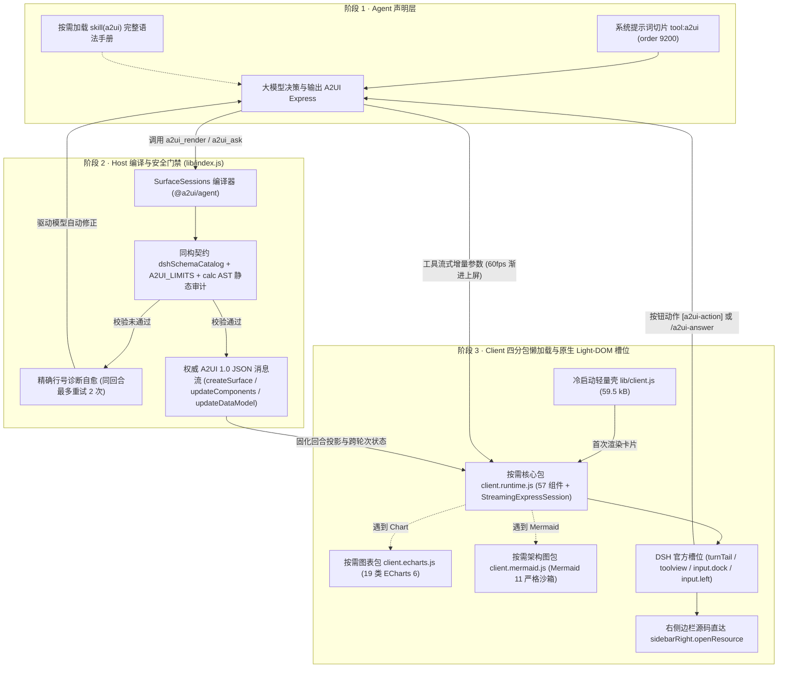

# 开发与技术架构文档（`dsh-genui-a2ui`）

[English](./DEVELOPMENT.md) | **简体中文** | [返回产品主页 README](../README.md)

本文档面向插件开发者、架构评审者与社区贡献者，详细介绍 `dsh-genui-a2ui` 的三阶段运行机制、**Google A2UI 1.0** 协议落地规范、**DeepSeek Harness（DSH）** 零 Hack 官方扩展点映射、四分包体积预算、**57 组件 Express DSL 语法契约**以及本地调试测试流程。

---

## 1. 整体三阶段运行架构

`dsh-genui-a2ui` 严格解耦为服务端（Node.js / Cordis）与客户端（Browser / React）三阶段流水线：

1. **模型声明输出（`A2UI Express`）** —— 当会话开启 A2UI 时，Host 注册高信噪比系统提示词切片（`tool:a2ui`，`order: 9200`，避免破坏内置提示词 KV-Cache 前缀）及按需加载的 `a2ui` Skill；大模型根据回答的信息拓扑自主调用 `a2ui_render` 或 `a2ui_ask` 输出 A2UI Express 声明。
2. **Host 编译校验与回合内自愈（`@a2ui/agent` + Zod）** —— `SurfaceSessions` 基于前后端同构契约 `dshSchemaCatalog`（`src/shared/catalog-schema.ts`）编译 Express 源码，执行安全阈值门禁（`A2UI_LIMITS`）与 `calc()` 静态 AST 校验；一旦遇到幻觉标签或参数错误，立即向模型返回精确诊断驱动同一回合自动修复（上限 `2` 次重试）。
3. **客户端 60fps 流式解析与原生 Light-DOM 渲染（`@a2ui/react`）** —— 工具参数流式生成期间，`StreamingExpressSession` 在浏览器端逐行增量解析实现 60fps 渐进上屏；工具执行完毕后无缝切换至 Host 编译产出的权威 A2UI 标准 JSON 消息（`createSurface`、`updateComponents`、`updateDataModel`）。



---

## 2. Google A2UI 1.0 六大核心原则的工程实现

`dsh-genui-a2ui` 严格遵循 **A2UI（Agent-to-User Interface）1.0** 官方设计原则，不做任何破坏确定性的私有协议魔改：

1. **Data, Not Code（声明式数据而非可执行代码，安全内生）** —— 模型绝不发送 HTML、JavaScript 脚本或 `iframe`，前后端边界只传递纯 JSON 声明消息，从协议层彻底杜绝代码注入与 XSS。
2. **Trusted Client Catalog（客户端受控组件白名单）** —— 模型只能调用 `dshSchemaCatalog` 注册并通过 Zod 严格校验的 **57 个组件**与 **25 个函数**，未知标签在编译期与渲染期双重拦截。
3. **LLM-Friendly Flat Streaming Graph（面向流式生成的扁平 ID 拓扑）** —— 容器采用扁平组件表 + `ChildSchema` ID 引用替代深层嵌套树，天然支持流式逐行上屏与按 Surface ID 原地增量更新（`surface("id", update=true)`）。
4. **Structure · State · Render 三层解耦** —— 组件结构（`components`）、JSON Pointer 响应式状态（`$/paths`）与 React 视图渲染完全分离。
5. **Thin UI, Thick Agent（薄视图、厚智能体职责边界）** —— 闭式标量公式（`calc`）、条件映射（`cond`）与表单即时校验（`?checks`）在本地 `0ms` 执行；开放式多步推理、外部数据查询与真实副作用通过 `[a2ui-action]` 或 `a2ui_ask` 交回 Agent。
6. **Host-Native Experience（宿主原生融合，零隔离税）** —— 零 Shadow DOM、零 `iframe`。所有组件直接在 Light DOM 中使用 DSH 原语与 `--dsw-*` 设计变量绘制，自动继承宿主亮暗主题与任意第三方社区皮肤。

---

## 3. 零 Hack 接入 DeepSeek Harness 官方扩展面

本插件 **100% 构建于 DSH 公开插件契约之上**，不抓取任何未公开 DOM 选择器、不调用私有 Electron IPC、不做运行时猴子补丁：

| 架构分层 | 使用的 DSH 官方公开扩展接口 | 在 `dsh-genui-a2ui` 中的职责 |
| :--- | :--- | :--- |
| **Host 服务层** | Cordis `tools`、`skills`、`commands`、`systemPrompt` | 注册 `a2ui_render`、`a2ui_ask`、4 个按域按需加载 Skill（`a2ui` / `a2ui-analytics` / `a2ui-devops` / `a2ui-forms`）、`/a2ui`、`/a2ui-answer` 与系统提示词引导。 |
| **Client 槽位层** | `tool.call.toolview`、`conversation.chat.turnTail`、`conversation.input.dock`、`conversation.input.left`、`conversation.user.text.node` | 挂载步骤内流式卡片、回合尾部主视图、常驻底部工作台、回合内阻塞确认台、输入框左侧胶囊开关及动作回执芯片。 |
| **会话投影服务** | `uiConversation.events.register`、`uiConversation.userText.register` | 将已完成的 `a2ui_render` 投影为支持历史回放与会话分叉的回合索引状态，并美化 `[a2ui-action]` 用户消息。 |
| **共享 UI 原语** | `@deepseek-ai/dsh-client-ui-primitives` | 直接复用宿主原生 `27` 项导出（`Switch`、`SegmentedControl`、`HoverCard`、`StateDot`、`ImageLightbox`、`FileTypeIcon`、`PathLabel`、`LinkIconRegular`、`JsonTree` 等）与 `--dsw-*` 语义变量。 |
| **右侧边栏联动** | `@deepseek-ai/dsh-client-ui-sidebar-right` | 在 `FileTree`、`DiffView`、`Code`、`LogViewer`、`SourceList` 中调用 `sidebarRight.openResource` 打开真实文件并定位行号。 |
| **客户端按需分包** | `window.__ModuleLoader__.load({ id: "dsh-genui-a2ui", entry })` | 按需动态加载界面运行时、ECharts 图表引擎与 Mermaid 引擎。 |

### 四分包按需懒加载体积明细

| 构建产物 | 原始体积 | Gzip 体积 | 职责与加载触发时机 |
| :--- | :--- | :--- | :--- |
| `lib/client.js` | **`59.5 kB`** | **`16.7 kB`** | 首屏冷启动轻量壳：注册 UI Slots、双语自适应、空会话原生轻提示与胶囊开关（构建与单测双重强制 `< 100 kB` 门禁）。 |
| `lib/client.runtime.js` | `1.32 MB` | ~`354 kB` | 仅当对话中真正挂载 A2UI 卡片时才加载（含 `@a2ui/react`、57 组件目录、TanStack Table、0ms 交叉筛选与流式防抖）。 |
| `lib/client.echarts.js` | `875.3 kB` | ~`289 kB` | 仅当卡片使用 `Chart` 组件时按需加载 ECharts 6（按需注册 19 类图表、标线模块、交叉筛选高亮、2× PNG 导出与 276px 紧凑自适应）。 |
| `lib/client.mermaid.js` | `3.51 MB` | ~`943 kB` | 仅当卡片使用 `Mermaid` 组件时按需加载 Mermaid 11（强制 `securityLevel: "strict"` + SVG 净化 + LRU-64 缓存）。 |
| `lib/index.js` | `747.1 kB` | `205.2 kB` | 自包含 Host ESM 产物（打包 `@a2ui/agent`、分域 Skill 压缩器、Express 编译降维预处理与同构 Zod 契约），用户安装时零运行时 npm 依赖。 |

---

## 4. 四种挂载模式与安全限制阈值

### 挂载模式映射

| 模式 | 调用方式 | DSH 官方 UI Slot | 生命周期与交互机制 |
| :--- | :--- | :--- | :--- |
| **Spotlight（默认）** | `a2ui_render({ ui, placement: "answer" })` | `conversation.chat.turnTail` | 挂载于回合尾部；最新回合可交互，被后续回合更新后自动转为只读历史快照。 |
| **Inline** | `a2ui_render({ ui, placement: "inline" })` | `tool.call.toolview` | 紧凑嵌入在工具步骤行内部（生成期间在步骤行内 60fps 流式渐进上屏）。 |
| **Persistent Dock** | `a2ui_render({ ui, placement: "dock" })` | `conversation.input.dock` | 常驻固定于输入框上方，跨轮次通过 `surface("id", update=true)` 原地刷新。 |
| **Blocking Ask** | `a2ui_ask({ ui, title })` | `conversation.input.dock` + `tool.call.toolview` | 挂起当前工具调用直至用户提交或跳过，通过内部命令 `/a2ui-answer` 在同一回合内恢复执行。 |

### Host 边界安全阈值（`A2UI_LIMITS`）

- `maxUiChars`：单次调用 Express 文本上限 `64,000` 字符
- `maxSurfacesPerCall`：单次调用最多 `8` 个 Surface
- `maxComponentsPerSurface`：单个 Surface 最多 `250` 个扁平组件节点
- `maxDataModelBytes`：数据模型序列化上限 `256,000` 字节
- `maxRepairsPerTurn`：单回合编译错误自愈重试上限 `2` 次

---

## 5. 57 组件 A2UI Express DSL 语法契约速查

每个界面以 `surface("snake_id")` 开头（增量刷新使用 `surface("snake_id", update=true)`），并将根组件赋值给 `root = ...`。可变字面量状态存入 `$/path`（如 `$/rate = 3.85`）；响应式计算表达式赋值给不带 `$/` 的局部变量（如 `monthly = calc(...)`），严禁将函数表达式写入 `$/path`。

### 1) 布局、网格与业务对象头（10）

| 组件 | Express 语法签名 | 技术说明 |
| :--- | :--- | :--- |
| `Card` | `Card(child)` | 使用 `--dsw-*` 边框与层级变量的主题自适应卡片容器。 |
| `Column` | `Column([c1, c2, ...], align?, justify?)` | 纵向弹性堆栈；直接子组件支持 `weight` 比例权重。 |
| `Row` | `Row([c1, c2, ...], justify?, align?)` | 横向弹性分栏（`justify` 支持 `"spaceBetween" \| "start" \| "center" \| "end"`）。 |
| `Grid` | `Grid([c1, c2, ...], columns?=3, gap?="sm"\|"md"\|"lg")` | 响应式多行等宽 CSS Grid 网格容器（移动端自动回退单列）。 |
| `Tabs` | `Tabs([{ title, child }, ...])` | 多标签页容器，跨标签切换保留 `$/path` 绑定状态。 |
| `Accordion` | `Accordion([{ title, subtitle?, badge?, open?, child }, ...], multiple?)` | 基于扁平 `ChildSchema` 引用的可折叠手风琴面板。 |
| `List` | `List([c1, c2, ...], direction?, align?)` | 纵向或横向列表容器。 |
| `Modal` | `Modal(trigger=Button(...), content=Column([...]))` | 无障碍模态对话框。 |
| `Divider` | `Divider(axis?)` | 水平或垂直分割线。 |
| `EntityHeader` | `EntityHeader(title, subtitle?, avatarText?, status?, statusLabel?, badge?, tags?, metrics?, actionLabel?, action?)` | B 端业务对象（租户/集群/服务/工单）概览头，复用宿主 `StateDot`。 |

### 2) 排版与提示（4）

| 组件 | Express 语法签名 | 技术说明 |
| :--- | :--- | :--- |
| `Text` | `Text(text, variant?="body"\|"caption"\|"h1".."h5")` | 完整 GFM Markdown 渲染，支持静态文本或 `$/path` 动态绑定。 |
| `Callout` | `Callout(title, message?, tone?="info"\|"success"\|"warning"\|"danger", collapsible?, child?)` | 四色语义横幅，支持折叠展开与嵌套子组件。 |
| `Badge` | `Badge(label, tone?="neutral"\|"info"\|"success"\|"warning"\|"danger"\|"outline"\|"solid")` | 语义状态胶囊标签。 |
| `Icon` | `Icon(name)` | 对齐 A2UI 标准图标名的内置矢量图标。 |

### 3) 指标、监控、时序与回执（9）

| 组件 | Express 语法签名 | 技术说明 |
| :--- | :--- | :--- |
| `Stat` | `Stat(label, value, delta?, trend?="up"\|"down"\|"neutral", caption?, spark?)` | KPI 指标卡，自动拆分数值与单位，支持内联 SVG 趋势数组 `spark=[...]`。 |
| `MetricRing` | `MetricRing(label, value, max?=100, unit?, sublabel?, tone?="auto", size?=88)` | 圆环水位仪表，支持 `tone="auto"` 随阈值自动变色。 |
| `Tracker` | `Tracker(data, title?, summary?, mode?="uptime"\|"category")` | Tremor 可用性时序条（悬停弹出宿主 `HoverCard`）与多段构成占比条。 |
| `KeyValue` | `KeyValue(items, title?, columns?=1..3, copyable?, bordered?=false)` | 对标 AntD `<Descriptions>`，支持 `bordered=true` 表格边框态与单元项 `span: 1..3`。 |
| `Steps` | `Steps(items, current?, direction?="vertical"\|"horizontal", title?)` | 阶段项：`{ title, description?, status?: "done"\|"active"\|"pending"\|"error", meta? }`。 |
| `Timeline` | `Timeline(items, title?, badge?)` | 时序事件流，支持可折叠 `detail` 与内嵌 `child` 子组件。 |
| `Schedule` | `Schedule(items, title?, range?, now?, action?)` | 维护窗口与排期甘特条，支持当前时间红线与阶段完成度。 |
| `Progress` | `Progress(value, max?=100, label?, tone?="brand"\|"success"\|"warning"\|"danger")` | 响应式进度条。 |
| `Result` | `Result(status="success"\|"info"\|"warning"\|"error"\|"empty", title, subtitle?, meta?, actionLabel?, action?, child?)` | 操作完成凭证回执单与结构化空状态。 |

### 4) 图表、拓扑、矩阵、层级树与数据表格（8）

| 组件 | Express 语法签名 | 技术说明 |
| :--- | :--- | :--- |
| `Chart` | `Chart(kind, data, title?, xField?, yField?, y2Field?, seriesField?, sizeField?, referenceLine?, referenceLabel?, stacked?, horizontal?, zoom?, height?, action?)` | 19 种 `kind`：`bar`、`line`、`area`、`combo`、`waterfall`、`pie`、`scatter`、`radar`、`parallel`、`funnel`、`gauge`、`heatmap`、`calendar`、`treemap`、`sunburst`、`sankey`、`boxplot`、`graph`、`candlestick`。 |
| `ServiceGraph` | `ServiceGraph(nodes, edges?, title?, direction?="LR"\|"TB", action?)` | 零依赖 DAG 拓扑图，支持健康度着色与上下游依赖高亮。 |
| `Mermaid` | `Mermaid(code, title?, caption?)` | 支持 11 类图表及 `10%–2000%` 矢量缩放、漫游与全屏查看。 |
| `Comparison` | `Comparison(options, rows, title?, action?)` | 多方案权衡矩阵（支持 `ok:` / `warn:` / `no:` 前缀与推荐列高亮）。 |
| `Matrix` | `Matrix(rows, columns, values, title?, cornerLabel?, unit?, colorScale?, showTotals?)` | 条件格式热力交叉表（留存队列、敏感度矩阵、RBAC 权限表）。 |
| `Table` | `Table(rows, columns?, title?, searchable?, pageSize?, exportable?, selectable?, batchLabel?, showSummary?, expandKey?, action?)` | 企业级 `ProTable`：排序、搜索、分页、密度切换、CSV/MD 导出、多选批处理、汇总行与 `expandKey` 行内展开详情抽屉。 |
| `Tree` | `Tree(nodes, title?, summary?, searchable?, expandedDepth?=3, action?)` | 通用层级树与 APM 调用链瀑布树（支持 `sharePct` 比例耗时条与宿主 `StateDot`）。 |
| `Kanban` | `Kanban(columns, title?, action?)` | 多泳道任务与工单分流看板。 |

### 5) 研发、接口调试与风控门禁（9）

| 组件 | Express 语法签名 | 技术说明 |
| :--- | :--- | :--- |
| `Code` | `Code(code, language?, lineNumbers?, title?, filePath?, line?)` | 语法高亮代码块；传入 `filePath` 与 `line` 可一键在右侧边栏打开源文件。 |
| `Terminal` | `Terminal(commands, title?, cwd?, shell?="zsh", maxHeight?)` | 运维命令执行手册，清晰分离 `$ cmd`、`stdout`、`stderr` 与 `exitCode`，仅复制纯净命令。 |
| `ApiEndpoint` | `ApiEndpoint(method, path, summary?, status?, latency?, baseUrl?, params?, headers?, requestBody?, responseBody?, action?)` | HTTP API 契约调试台，复用宿主 `JsonTree` 并支持安全转义复制 `cURL`。 |
| `ApprovalCard` | `ApprovalCard(title, summary?, severity?="high", scope?, impacts?, confirmLabel?, approveLabel?, rejectLabel?, approveAction?, rejectAction?)` | B 端高危变更风控审批门禁，联动宿主 `Switch` 二次确认解锁放行。 |
| `DiffView` | `DiffView(before, after, title?, language?, mode?="unified"\|"split", filePath?, line?)` | 行级差异对比、增删统计、单栏/双栏切换及右侧栏源码定位。 |
| `LogViewer` | `LogViewer(entries, title?, searchable?, defaultLevel?, maxHeight?, action?)` | 结构化日志与堆栈排障台，支持级别筛选与右侧栏源码跳转。 |
| `FileTree` | `FileTree(items, title?, expandedDepth?, action?)` | 复用宿主 `FileTypeIcon` 与 `PathLabel` 的工作区文件树。 |
| `JsonTree` | `JsonTree(data, title?, expandedDepth?, copyable?)` | 复用 `@deepseek-ai/dsh-client-ui-primitives` 的原生 `JsonTree`。 |
| `SourceList` | `SourceList(items, title?, action?)` | 溯源引用与证据列表，自动调用宿主 `LinkIconRegular` 与 `FileTypeIcon`。 |

### 6) 表单交互、建议卡片与多媒体（17）

| 组件 | Express 语法签名 | 技术说明 |
| :--- | :--- | :--- |
| `Button` | `Button(child, variant?="primary"\|"default"\|"borderless", action=Event(name, context?, userMessage?))` | 触发 `[a2ui-action]` 或本地动作；关联 `?checks` 未通过时自动禁用。 |
| `NumberInput` | `NumberInput(label, $/num, min?, max?, step?=1, unit?, prefix?)` | 对标 AntD `InputNumber` 的高精度步进数字框，直绑数字型 `$/path`。 |
| `MultiSelect` | `MultiSelect(label, options, value=$/strList, placeholder?, searchable?=true, allowCreate?=false, maxTagCount?=5)` | 对标 AntD `Select(mode="multiple"\|"tags")`，支持折叠胶囊与回车自建标签。 |
| `DateRange` | `DateRange(label, start=$/start, end=$/end, presets?=true, enableTime?=false)` | 对标 AntD `RangePicker`，含 `今日/近7天/近30天/近90天` 预设与跨度统计。 |
| `TreeSelect` | `TreeSelect(label, nodes, value=$/str, placeholder?, searchable?=true)` | 对标 AntD `TreeSelect / Cascader`，触发器回显完整层级面包屑路径。 |
| `CheckCard` | `CheckCard(label, options, value?=$/val, multiple?=false, columns?=3, action?)` | 双模组件：绑定 `value` 时对标 AntD Pro `<CheckCard.Group>`，仅传 `action` 时对标 `@ant-design/x` `<Prompts>` 追问建议卡。 |
| `Segmented` | `Segmented(label, options, value=$/str)` | 优先委托宿主原生 `SegmentedControl`，直绑标量字符串。 |
| `Select` | `Select(label, options, value=$/str, placeholder?, searchable?)` | 单选下拉框（≤8 项无搜索时委托宿主 `Menu`，否则启用玻璃态搜索浮层）。 |
| `Switch` | `Switch(label, $/bool, description?)` | 委托宿主原生 `Switch` 的布尔开关行。 |
| `Slider` | `Slider(label, min, max, $/value, steps?)` | `steps = (max - min) / 步长`，边界值为静态数字。 |
| `ChoicePicker` | `ChoicePicker(label, options, value=$/list, variant?="mutuallyExclusive"\|"multipleSelection", displayStyle?="chips"\|"checkbox")` | 绑定值统一为选中值字符串数组（如 `["v3"]`）。 |
| `TextField` | `TextField(label, value=$/text, variant?="shortText"\|"longText"\|"number", placeholder?)` | 支持挂载实时表单校验 `?checks`。 |
| `CheckBox` | `CheckBox(label, value=$/flag)` | 布尔值双向绑定。 |
| `DateTimeInput` | `DateTimeInput(label, value=$/iso, enableDate?, enableTime?, min?, max?)` | ISO 日期时间字符串绑定。 |
| `Image` | `Image(url, alt?, fit?)` | 点击可唤起宿主原生 `ImageLightbox` 全屏灯箱预览。 |
| `AudioPlayer` | `AudioPlayer(url, description?)` | 原生音频播放控件。 |
| `Video` | `Video(url)` | 原生 HTML5 视频播放控件。 |

---

## 6. 25 个客户端响应式与校验函数参考

- **`0ms` 安全代数公式、查表与聚合（5）**：
  - `calc(expr, vars, decimals?)`：递归下降安全公式求值器，支持 `+ - * / ^ % ( ) ? : == != < <= > >= && ||` 与 `pow, sqrt, exp, log, ln, log10, abs, min, max, clamp, round, floor, ceil, pmt(ratePerPeriod, nper, pv)`；编译期静态校验真实嵌套深度（`<= 36`）与节点数（`<= 128`）。
  - `lookup(key, table, fallback?)`：深度 1 映射查表（自动解包单选 `ChoicePicker` 单元素数组），替代多层嵌套 `cond(eq(...))`。
  - `cond(condition, truthy, falsy)`、`sum(items, field?)`、`avg(items, field?)`
- **比较与布尔逻辑（7）**：
  - `eq(a, b)`（自动解包单选 `ChoicePicker` 单元素数组）、`gt(a, b)`、`lt(a, b)`、`includes(items, value)`、`and([...])`、`or([...])`、`not(x)`
- **格式化与拼接（6）**：
  - `formatNumber(value, decimals?, grouping?)`、`formatCurrency(value, currency, decimals?, grouping?)`、`formatDate(value, format)`、`formatString(template)`、`concat(items)`、`pluralize(...)`
- **表单校验（`?checks`）与本地动作（7）**：
  - `required(value)`、`regex(value, pattern)`、`length(value, min?, max?)`、`numeric(value, min?, max?)`、`email(value)`、`copyText(text)`、`openUrl(url)`

---

## 7. 本地开发、测试与隔离验证

```bash
# 从锁文件严格安装依赖
npm ci

# TypeScript 类型检查
npm run typecheck

# 构建 Host ESM + 4 个 Client 分包（自动校验首屏 < 100 kB 门禁）
npm run build

# 运行全部 22 个测试套件 / 94 项单元、React 架构最佳实践、契约与分包门禁测试
npm test

# 运行 28 用例 LLM 生成与自修复基准测试（支持 --mode=mock 或 --mode=live --model=deepseek-chat）
npm run eval:llm -- --mode=mock --strategy=both

# 核验与本机 DeepSeek Harness.app 内部 27 项模块导出及 Slots 的契约兼容性
npm run check:host-api

# 预览 npm 发布包文件清单与体积（精确 18 个文件）
npm pack --dry-run

# 启动独立隔离的 DSH Web 环境（.dsh-dev）与脚本化 Mock LLM（http://127.0.0.1:18991）
node scripts/dev-env.mjs setup
node scripts/dev-env.mjs serve
```

### 核心源码目录说明

- `src/index.ts` —— Host 端 Cordis 插件入口（注册工具、4 域分域 Skill、命令与系统提示词切片）
- `src/host/` —— `a2ui_render`、`a2ui_ask`、`SurfaceSessions` 编译器（事务级状态回滚）、分域 Skill 压缩器（`prompt-compact.ts`）与 28 用例评测套件（`eval-suite.ts`）
- `src/shared/` —— 前后端同构 `dshSchemaCatalog`（57 组件 / 25 函数）、Express 降维预处理（`express-preprocess.ts`）、跨端协议类型 `wire-types.ts`、`calc` 公式解析器、安全脱敏与双语词条
- `src/client/index.ts` —— `59.5 kB` 首屏冷启动轻量壳与输入框胶囊开关
- `src/client/dom-hooks.ts` —— 全仓唯一底层 DOM / ECharts PNG 导出 / 流式高度稳定器 / Mermaid 生命周期隔离层（业务 `.tsx` 强制 `0` `useEffect`）
- `src/client/chunks/` —— 按需加载分包入口（`runtime-chunk.ts`、`echarts-chunk.ts`、`mermaid-chunk.ts`）
- `src/client/catalog/` —— 57 个 Light-DOM 原生组件与 25 个客户端函数的具体实现
- `build/` —— `tsdown` 五目标构建预设与 DSH 宿主模块外部化配置
- `scripts/` —— Host API 契约核验脚本（`check-host-api.mjs`）、真模型评测脚本（`eval-llm.mjs`）与隔离演示环境（`dev-env.mjs`、`mock-llm.mjs`）
- `AGENTS.md` —— `306px` 半宽优先 `@container` 排版、ECharts `276px` 防碰撞契约与发版前视觉回归工程规范
