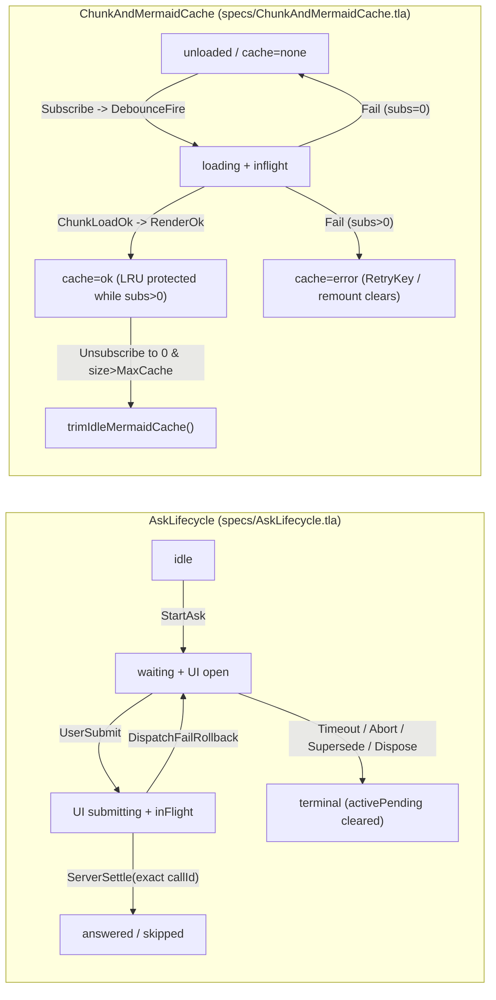
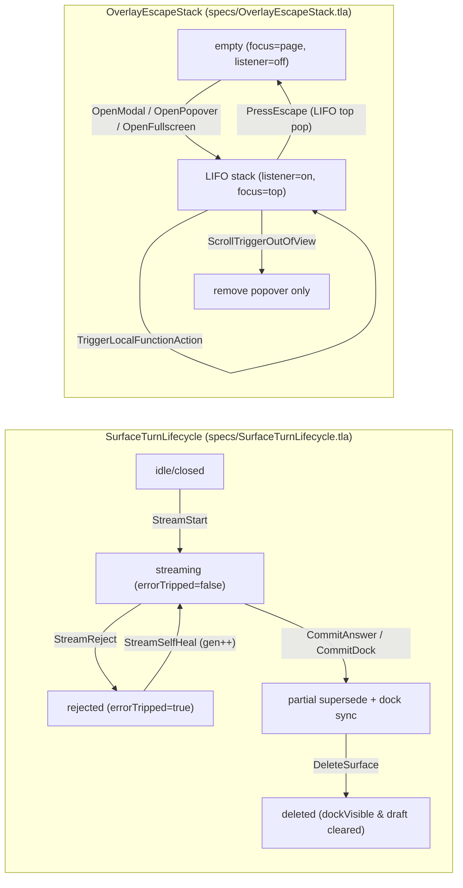

# ADR-0008: Formal Verification (TLA+), Path-Encoded Boundaries, Architectural Invariants & Bundle Ratchet

- **Status**: Accepted
- **Date**: 2026-11-22
- **Related**: [ADR-0001](./ADR-0001-four-chunk-bundle-and-private-zod.md), [ADR-0002](./ADR-0002-zero-useeffect-react-architecture.md), [ADR-0006](./ADR-0006-security-boundaries-and-sanitization.md), [ADR-0007](./ADR-0007-narrow-container-layout-and-echarts-collision.md)

## Context

Across `v0.4.1–v0.4.6`, four classes of defects recurred across modules even with strong unit-test coverage:

1. **Concurrent / async state-machine interleavings**: `PendingAskRegistry` settlement vs timeout/abort/rollback, `chunk-loader.ts` Mermaid cache error-poisoning / permanent skeleton / LRU oversizing, multi-turn `deleteSurface` + partial superseding + stream self-heal, and nested Modal/Popover LIFO `Escape` handling.
2. **Cross-file pattern regressions**: CSS `@container` self-queries, lone `@media (max-width)` rules without `@container`, direct `localStorage` or `window.addEventListener('keydown')` calls bypassing centralized guards, raw `<input type="date">`, or HTML tags inside ECharts `richText` tooltips.
3. **Implicit cold-boot vs lazy-runtime boundaries**: Shell and runtime modules previously lived side-by-side in `src/client/`, surfacing accidental cold-boot dependency leaks only at bundle time.
4. **Unratcheted lazy chunk growth**: Only `lib/client.js` raw bytes had a hard build gate, leaving gzip size and the other 4 outputs (`lib/index.js`, `lib/client.runtime.js`, `lib/client.echarts.js`, `lib/client.mermaid.js`) without automated regression limits.

## Decisions

### 1. TLA+ Formal Verification for the 4 Core Concurrent State Machines

All 4 concurrent subsystems are modeled in `specs/*.tla` + `specs/*.cfg` and verified exhaustively with TLC (`scripts/verify-tla.mjs`, `npm run verify:tla`, governed by `.agents/skills/formal-verify/SKILL.md`):

**First real bug caught by TLC**: Running `ChunkAndMermaidCache.tla` immediately produced an 8-step counterexample violating `BoundedIdleCache`: when `> MAX_MERMAID_CACHE_ENTRIES` diagrams were simultaneously mounted (legitimately bypassing LRU eviction while active) and subsequently unmounted, `subscribeMermaidDiagram`'s cleanup function never trimmed `mermaidDiagramCache` back to `MAX_MERMAID_CACHE_ENTRIES`. Fixed in `src/client/chunk-loader.ts` via shared `trimIdleMermaidCache()` invoked on both write and zero-subscriber unmount.

### 2. Context-Encoded Directory Boundaries & Biome Overrides

- Cold-boot shell modules live explicitly in `src/client/shell/` (plus `src/client/index.ts`).
- Lazy runtime modules live explicitly in `src/client/runtime/` (`SurfaceView.tsx`, `streaming.ts`, `ErrorBoundary.tsx`).
- Pure/isomorphic logic lives in `src/shared/` and `src/client/catalog/*-helpers.ts`.
- `biome.json` `overrides` and `scripts/check-invariants.mjs` enforce these boundaries at lint/edit time rather than waiting for bundle failure.

### 3. 12-Rule AST & CSS Architectural Invariant Gate

`scripts/check-invariants.mjs` (integrated into `npm run lint` and CI) enforces 12 static invariants derived from historical regressions: `css-media-requires-container`, `css-no-container-self-query`, `no-direct-localstorage`, `no-direct-window-keydown`, `no-raw-native-date-input`, `no-html-in-echarts-richtext`, `no-useeffect-outside-dom-hooks`, `pure-module-isolation`, `shell-runtime-boundary`, `security-no-dangerous-sinks`, `locale-key-parity`, and `no-weight-full-width-override`.

### 4. 5-Chunk Raw + Gzip Bundle Budget Ratchet & Deterministic Replay / Visual QA Automation

- `.bundle-budget.json` + `scripts/check-bundle-budget.mjs` + `build/preset.ts` enforce both raw and gzip (`level: 9`) budgets across all 5 build outputs (`index.js`, `client.js`, `client.runtime.js`, `client.echarts.js`, `client.mermaid.js`), with `--ratchet` for monotonic tightening.
- `tests/deterministic-replay-fuzz.spec.ts` verifies random-chunk streaming equivalence across all 32 showcases, deterministic multi-turn replay, linear-time compiler/security fuzzing, and `240px` ultra-narrow layout math.
- `.eval-baseline.json` + `scripts/eval-llm.mjs --check-thresholds` gate skill routing/compile KPIs.
- `scripts/visual-qa-bot.mjs` automates headless Chrome CDP DOM-geometry auditing (Dark & Light) and `screenshots.json` capture with zero external npm dependencies.

## Consequences

- Regressions in concurrency, CSS container queries, cold-boot boundaries, locale parity, and bundle size fail fast in `npm run lint`, `npm run build`, `npm test`, and `npm run verify:tla:strict`.
- Adding a new concurrent state machine or fixing a recurring bug pattern follows the flywheel: reproduce via TLA+ or AST rule → fix code → lock invariant permanently.

## 2026-11-26 Audit & Sync Addendum

Following `v0.5.6–v0.5.9` (including [ADR-0009](./ADR-0009-modular-chunks-streaming-perf-and-catalog-convergence.md)), a formal drift audit uncovered and resolved two structural gaps:

1. **Strict CI/Release TLC Enforcement**: `.github/workflows/ci.yml` and `.github/workflows/release.yml` previously ran `npm run verify:tla` without `--download --strict`, causing TLC to silently skip whenever `tla2tools.jar` was uncached on hosted runners. Added `npm run verify:tla:strict` (`node scripts/verify-tla.mjs --download --strict`), `actions/cache@v4` for `~/.cache/tla`, Windows `java.exe` / `JAVA_HOME_*` lookup, and comma-safe TLC state-count parsing.
2. **Spec-to-Code Re-Alignment & Mutation Proofs**:
   - `AskLifecycle.tla`: modeled indefinite waits (`timeout: -1`, `hasTimeout[c]`) and per-session pending capacity (`MaxPending`), adding `PendingWithinCapacity`, `IndefiniteAskNeverTimesOut`, `BoundedWaitingEventuallyResolves`, and `InFlightMessageEventuallyDrains`.
   - `SurfaceTurnLifecycle.tla`: modeled cross-session draft flush (`SwitchSession` + `NoCrossSessionDirtyDraft`) and per-widget `ErrorBoundary` isolation (`WidgetRenderFail`, `WidgetErrorIsolatedFromRoot`, `DeletedHasNoWidgetError`, and `resetKey` reset on `StreamAbortToClosed`).
   - `OverlayEscapeStack.tla`: modeled unmanaged host overlay nesting (`OpenHostOverlay`, `FocusUnmanagedHost`, `PressEscapeInUnmanagedHost`) and modal-to-portal-popover Tab focus trapping (`TabInModalWithPortalPopover`, `UnmanagedHostFocusRequiresOpenHost`, `HostOverlayDoesNotBlockNestedManaged`, `PortalTabKeepsPopoverFocus`).
   - `ChunkAndMermaidCache.tla`: verified `in sync` against refactored `createLazyChunkStore` (`runtime`/`streaming`/`echarts`) and Mermaid LRU cache.
   - All newly added invariants were verified able-to-fail via scratch mutation checks before advancing the Sync Anchor in `.agents/skills/formal-verify/SKILL.md`.
